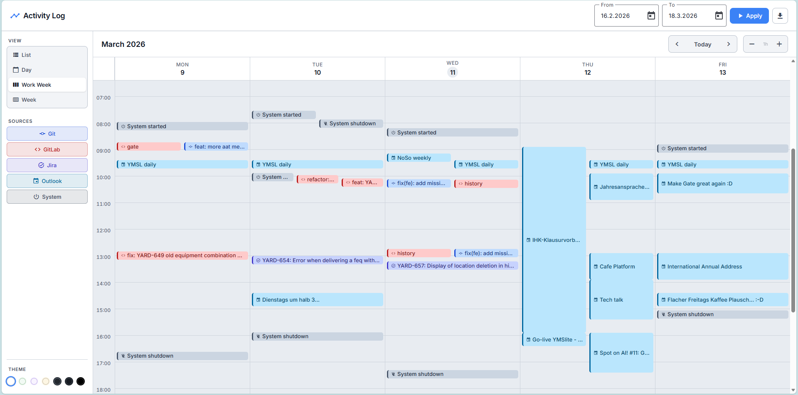

# activity-log - your MONI companion when your outlook calendar just aint doing it

A unified activity tracker that aggregates everything you did into a single timeline — commits, GitLab events, Jira issues, calendar meetings, and system events.

Two ways to use it:
- **UI mode** — start a local web server, open the dashboard in your browser, explore interactively
- **CLI mode** — run a single command, get a file, no server needed

## Screenshots





## Data sources

| Source | What it collects |
|---|---|
| **Git** | Commits from all local repositories |
| **GitLab** | MRs, pushes, comments, reviews |
| **Jira** | Issues you worked on or reported |
| **Outlook** | Calendar events (via local Outlook desktop app) |
| **System** | Boot, shutdown, sleep, and wake events (Windows Event Log) |

When a local git commit matches a GitLab push event (same commit SHA), they are merged into a single **git/lab** entry instead of appearing twice.

## Requirements

- [Node.js](https://nodejs.org) >= 20
- [pnpm](https://pnpm.io) >= 10
- Git installed locally
- Windows (for Outlook and System collectors — others work cross-platform)

## Setup

```bash
git clone https://git.inform-software.com/gb100/shared/playground/tzaharin/activity-log.git
cd activity-log
pnpm install
cp .env.example .env   # fill in your credentials
```

---

## Option A — UI (web dashboard)

### First-time only: build the dashboard

```bash
pnpm install:dashboard
pnpm build:dashboard
```

### Start the server

```bash
pnpm start
```

Open [http://localhost:3000](http://localhost:3000). The last 30 days are collected automatically on startup. Use the date pickers in the header to change the range and re-collect on the fly.

The header has two export buttons:
- **Markdown** (`description` icon) — downloads a `.md` summary of the current filtered view
- **JSON** (`data_object` icon) — downloads the raw entries as `.json`

### Development mode (hot reload)

```bash
pnpm dev
# API server  → http://localhost:3001
# Dashboard   → http://localhost:4200  (live reload)
```

---

## Option B — CLI

No dashboard build needed.

```bash
pnpm collect                          # last 30 days → logs/activity_log.json
pnpm collect --range today
pnpm collect --range yesterday
pnpm collect --range week
pnpm collect --range lastweek
pnpm collect --range month
pnpm collect --range lastmonth
pnpm collect --since 2026-03-01 --until 2026-03-18
```

### Output format

Default output is JSON. Use `--format markdown` to get a Markdown summary instead:

```bash
pnpm collect --format json            # → logs/activity_log.json  (default)
pnpm collect --format markdown        # → logs/activity_log.md
```

Override the output path with `--output`:

```bash
pnpm collect --range week --output reports/week.json
pnpm collect --range week --format markdown --output reports/week.md
```

### Other options

```bash
--git-dirs /path/to/repo1,/path/to/repo2   # scan specific repos instead of auto-discovering
```

---

## Environment variables

Copy `.env.example` to `.env` and fill in the sources you want to enable. Any source without credentials is silently skipped.

| Variable | Description |
|---|---|
| `GITLAB_URL` | Your GitLab instance URL |
| `GITLAB_TOKEN` | GitLab personal access token |
| `GITLAB_USER` | Your GitLab username |
| `JIRA_URL` | Your Jira instance URL |
| `JIRA_EMAIL` | Your Jira account email |
| `JIRA_TOKEN` | Jira API token (or PAT for Jira Data Center) |
| `JIRA_INSECURE` | Set to `true` to skip TLS verification (self-signed certs) |
| `GIT_DIRS` | Comma-separated paths to Git repos (auto-discovers from home dir if not set) |
| `PORT` | Server port (default: `3000`, UI mode only) |

Outlook and System collectors require no credentials — they read from the local Outlook app and Windows Event Log respectively.

---

## Project structure

```
activity-log/
├── src/
│   ├── server.ts              Express server (UI mode)
│   ├── cli.ts                 Standalone CLI (CLI mode)
│   ├── types.ts               Shared TypeScript types
│   ├── utils.ts               Date utilities, markdown formatter, git/gitlab merge
│   ├── cache.ts               File-based TTL cache for API responses
│   └── collect/
│       ├── git.ts             Local Git collector
│       ├── gitlab.ts          GitLab API collector
│       ├── jira.ts            Jira API collector
│       ├── outlook.ts         Outlook COM collector (Windows)
│       └── system.ts          Windows Event Log collector
├── dashboard/                 Angular app (UI mode only)
│   └── src/app/
│       ├── components/        header, filters, timeline, calendar views
│       ├── services/          ActivityService, ThemeService
│       └── models/            TypeScript interfaces
├── logs/                      Generated output (gitignored)
├── .env.example
├── package.json
└── README.md
```
