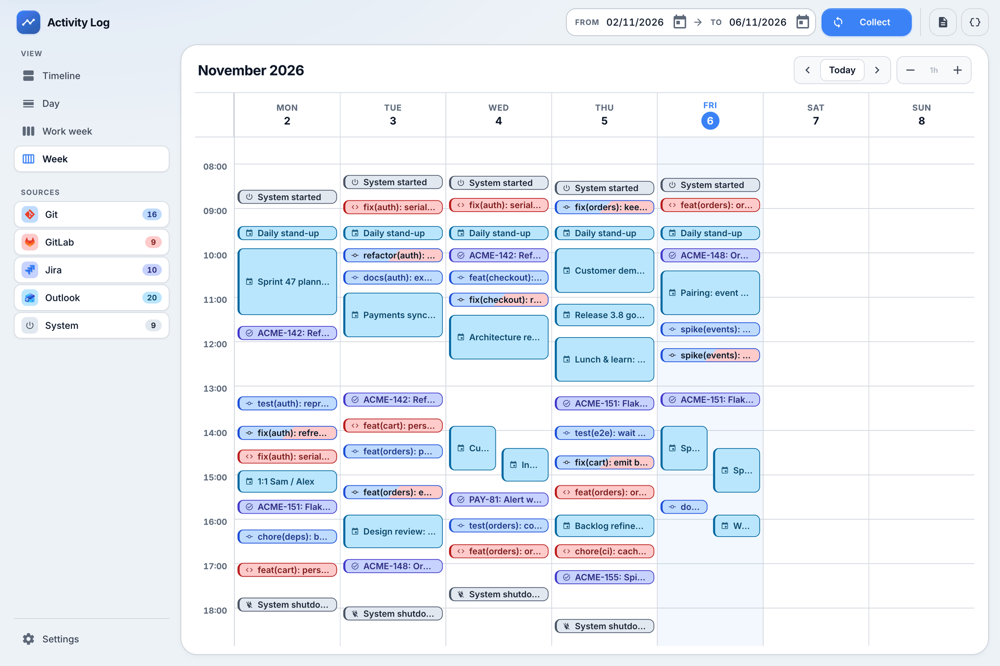
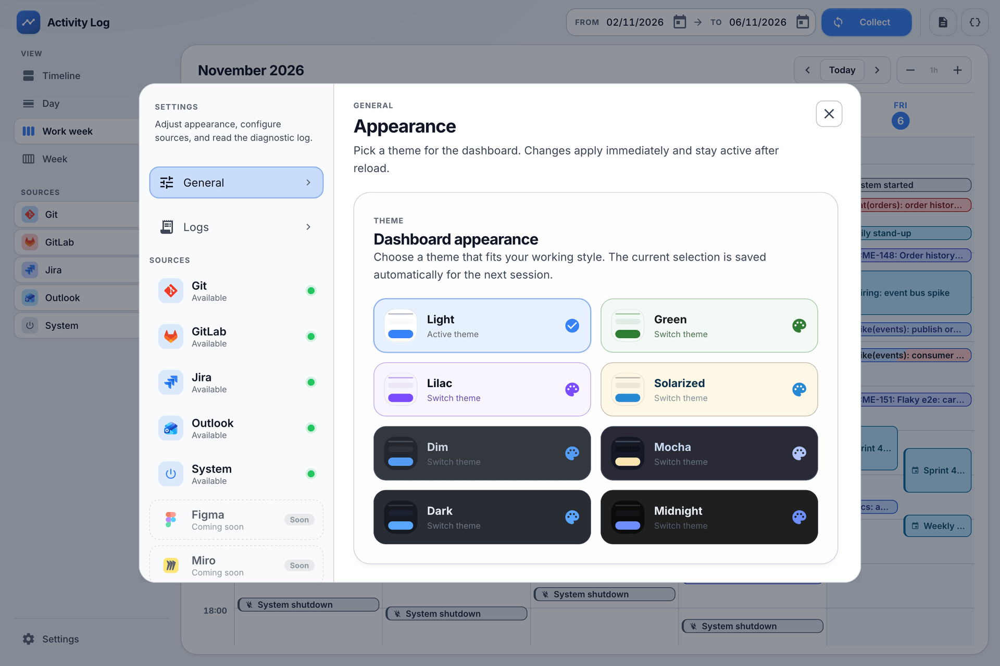
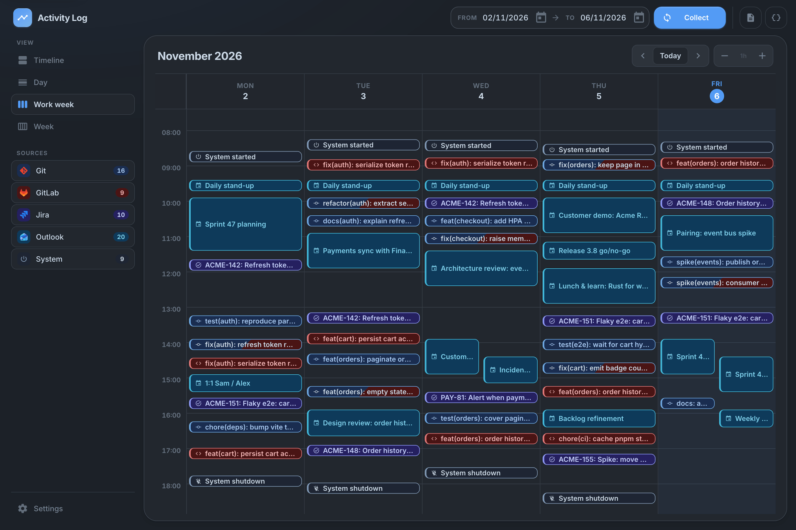
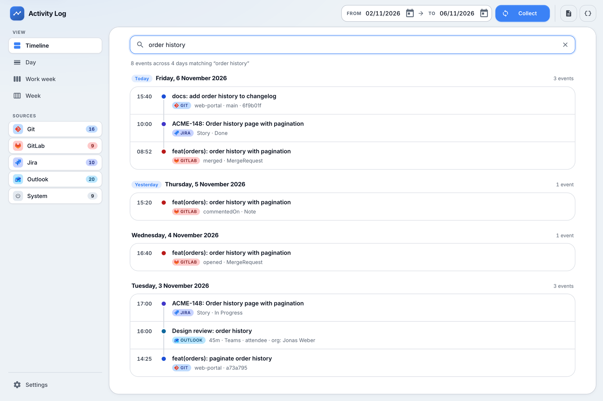
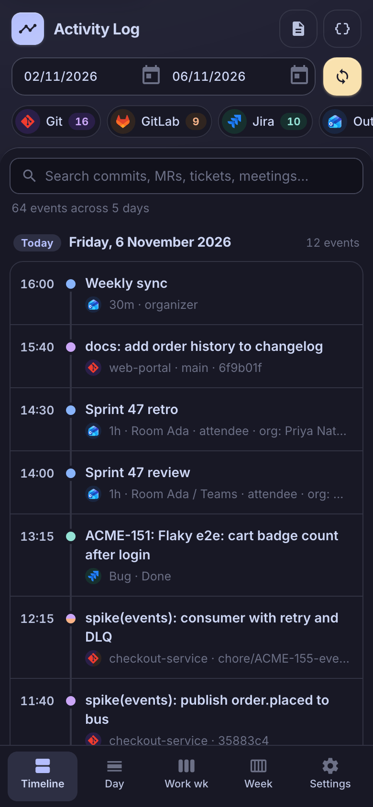
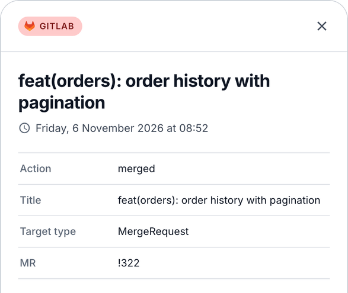

<p align="center">
  
</p>

<h1 align="center">Activity Log</h1>

<p align="center">
  A unified activity tracker that aggregates everything you did into a single timeline — commits, GitLab events, Jira issues, calendar meetings, and system events.
</p>

<p align="center">
  <a href="#data-sources">Data sources</a> ·
  <a href="#features">Features</a> ·
  <a href="#sources-in-detail">Sources in detail</a> ·
  <a href="#getting-started">Getting started</a> ·
  <a href="#configuration">Configuration</a> ·
  <a href="#development">Development</a>
</p>

<p align="center">
  
</p>

<p align="center"><sub>Work week view. All screenshots use demo data.</sub></p>

## Data sources

| Source      | What it collects                                                                  |
| ----------- | --------------------------------------------------------------------------------- |
| **Git**     | Commits from local repositories via an embedded Git library                       |
| **GitLab**  | MRs, pushes, comments, reviews                                                    |
| **Jira**    | Issues assigned to or reported by you                                             |
| **Outlook** | Calendar events from the running Outlook desktop app via native desktop APIs      |
| **System**  | Boot and shutdown events from the Windows Event Log and the macOS session history |

When a local git commit matches a GitLab push event (same commit SHA), they are merged into a single **git/lab** entry instead of appearing twice.

The entry types, displayed fields, supported platforms and configuration of each source are listed under [Sources in detail](#sources-in-detail).

## Features

### Four views

The sidebar switches between **Timeline** (a list grouped by day, newest day first), **Day**, **Work week** (Monday to Friday) and **Week** (Monday to Sunday). The three calendar views have previous, Today and next buttons and a zoom control.

<table>
  <tr>
    <td width="50%"><br><sub>Timeline</sub></td>
    <td width="50%"><br><sub>Day</sub></td>
  </tr>
  <tr>
    <td width="50%"><br><sub>Work week</sub></td>
    <td width="50%"><br><sub>Week</sub></td>
  </tr>
</table>

### Themes

**Settings → General** has a theme picker with eight themes: Light, Green, Lilac, Solarized, Dim, Mocha, Dark and Midnight. The selected theme is stored in the browser's local storage.

<p align="center">
  
</p>

<table>
  <tr>
    <td width="25%"><br><sub>Light</sub></td>
    <td width="25%"><br><sub>Green</sub></td>
    <td width="25%"><br><sub>Lilac</sub></td>
    <td width="25%"><br><sub>Solarized</sub></td>
  </tr>
  <tr>
    <td width="25%"><br><sub>Dim</sub></td>
    <td width="25%"><br><sub>Mocha</sub></td>
    <td width="25%"><br><sub>Dark</sub></td>
    <td width="25%"><br><sub>Midnight</sub></td>
  </tr>
</table>

### Search

The Timeline view has a search box that filters the entries as you type, ignoring case. <kbd>/</kbd> focuses it and <kbd>Esc</kbd> clears it. It matches fields such as commit message, repository, branch, GitLab event title, Jira key and status, and meeting title, location and organizer.

<p align="center">
  
</p>

### Source filter

Every source has a chip with its entry count. Click a chip to toggle that source. Double-click it to show only that source, and double-click it again to show all sources.

<p align="center">
  
</p>

<p align="center"><sub>Work week after double-clicking the Outlook chip.</sub></p>

### Entry details

Clicking an entry in any view opens a panel with the fields collected for it. The fields of each source are listed under [Sources in detail](#sources-in-detail).

<p align="center">
  
</p>

### git/lab merge

A local commit whose SHA matches a GitLab push event is shown once, with a **git/lab** badge. Its detail panel lists the Git fields and the GitLab fields in separate sections.

<p align="center">
  
</p>

### Export

The two buttons in the header export the current filtered view (date range, active sources and, in the Timeline view, the search query) as Markdown grouped by day or as JSON. The browser downloads the file as `activity-<from>-<to>.md` or `.json`; the desktop app opens a native save dialog instead.

Start of the Markdown export of the demo data:

```markdown
# Activity Summary - 2026-11-02 to 2026-11-06

Total: 64 events

## Friday, 6 November 2026

- **[outlook]** Weekly sync (16:00 · 30m)
- **[git]** `web-portal` docs: add order history to changelog (15:40)
- **[outlook]** Sprint 47 retro @ Room Ada (14:30 · 1h)
- **[outlook]** Sprint 47 review @ Room Ada / Teams (14:00 · 1h)
- **[jira]** ACME-151: Flaky e2e: cart badge count after login [Done] (13:15)
- **[git]** `checkout-service` spike(events): consumer with retry and DLQ (12:15)
```

### Source settings and startup status

**Settings** lists every source with the result of its startup check and the operating systems it supports. In the desktop app, each source pane also has the connection settings for that source. Secret fields are write-only and only show whether a value is set.

<p align="center">
  
</p>

### Logs

**Settings → Logs** shows the in-memory diagnostic log of provider checks, collection runs and settings saves. It can be filtered to warnings or errors, copied and cleared.

<p align="center">
  
</p>

### Phone-width layout

At a width of 640px or less, the view switcher and Settings move to a bottom tab bar and the source chips become a horizontally scrolling row.

<table align="center">
  <tr>
    <td align="center"><br><sub>Timeline (Mocha)</sub></td>
    <td align="center"><br><sub>Day (Light)</sub></td>
  </tr>
</table>

### Per-day cache

GitLab and Jira results are cached on disk per day, so a collection only requests the days that are missing or stale. The Logs pane records what was fetched and what was served from cache. TTLs and the cache location are described under [Configuration](#configuration).

### CLI

`pnpm cli:collect` runs a collection without the dashboard and writes JSON (the default) or Markdown to a file. All flags are listed in the CLI reference under [Development](#development).

```bash
pnpm cli:collect --range week
pnpm cli:collect --range week --format markdown --output reports/week.md
```

## Sources in detail

For each source, this section lists the entries it produces, the line shown under the entry title in the Timeline view, and the fields of the detail panel. A field without a value is left out of the panel. The calendar views show the entry title only. The panels below show demo data.

### Git

<table>
<tr>
<td width="56%" valign="top">

- **Entries:** one per commit whose author email matches the repository's `user.email`, read from all refs of each repository. The title is the commit subject.
- **Timeline line:** repository · branch · first 7 characters of the commit hash
- **Detail panel:** Repository (folder name), Branch, Commit (full hash), Author (email), Message
- **Branch:** only set for the commit that is the checked-out `HEAD` of its repository. Other commits have no branch.
- **Merged entries:** a commit that matches a GitLab push event becomes a [git/lab entry](#gitlab-merge) with an additional GitLab section.
- **Platforms:** Windows, macOS, Linux
- **Configuration:** `GIT_DIRS` (optional). A listed folder that contains `.git` is used as a repository; any other folder is searched for repositories up to four levels deep. Repositories without `user.email` are skipped.

</td>
<td width="44%" valign="top"></td>
</tr>
</table>

### GitLab

<table>
<tr>
<td width="56%" valign="top">

- **Entries:** one per event in the GitLab event feed of `GITLAB_USER`. The title is the title of the event's target, for example the merge request title. An event without a target title shows its action as the title.
- **Actions:** `pushedTo`, `created`, `opened`, `closed`, `reopened`, `updated`, `merged`, `accepted`, `commentedOn`, `approved`, `joined`, `destroyed` and `expired`. Any other action is stored as `unknown`.
- **Timeline line:** action · target type as reported by GitLab, for example `merged · MergeRequest` or `commentedOn · DiffNote`
- **Detail panel:** Action, Title and Target type. MR (`!` and the target IID) when the event has one. Branch and Commits for push events. File, Comment and Resolved for comments.
- **Merged entries:** a push event whose commit SHA matches a local commit is shown inside that commit's [git/lab entry](#gitlab-merge) instead of as its own entry.
- **Platforms:** Windows, macOS, Linux
- **Configuration:** `GITLAB_URL`, `GITLAB_TOKEN` and `GITLAB_USER` (all required). Results use the [per-day cache](#per-day-cache).

</td>
<td width="44%" valign="top"></td>
</tr>
</table>

### Jira

<table>
<tr>
<td width="56%" valign="top">

- **Entries:** taken from issues assigned to or reported by you. The title is the issue key followed by the summary.
  - `issueCreated`: the issue was created in the date range.
  - `statusChanged`: one entry per status change in the date range.
  - `issueUpdated`: the issue was updated in the date range without a status change in that range.
- **Timeline line:** issue type · status
- **Detail panel:** Event, Key, Title, Status and Issue type. From status and To status for status changes.
- **Platforms:** Windows, macOS, Linux
- **Configuration:** `JIRA_URL` and `JIRA_TOKEN` (required), `JIRA_INSECURE` (optional). Results use the [per-day cache](#per-day-cache).

</td>
<td width="44%" valign="top"></td>
</tr>
</table>

### Outlook

<table>
<tr>
<td width="56%" valign="top">

- **Entries:** one per event in Outlook's default calendar that overlaps the date range. The title is the event subject.
- **Timeline line:** duration · location · `organizer` or `attendee` · `org:` and the organizer's name when you are not the organizer
- **Detail panel:** Title, Duration, Location, Organizer and Role (Organizer or Attendee)
- **Calendar views:** a meeting is drawn as a block that spans its duration.
- **Platforms:** Windows, macOS
- **Configuration:** none. Outlook has to be installed and running. On macOS it also needs a signed-in Exchange account.

</td>
<td width="44%" valign="top"></td>
</tr>
</table>

### System

<table>
<tr>
<td width="56%" valign="top">

- **Entries on Windows:** System event log events 6005 (`boot`, "System started"), 6006 (`shutdown`, "System shutdown") and 6008 (`unexpected_shutdown`, "Unexpected shutdown").
- **Entries on macOS:** the reboot and shutdown records of the `last` command, as `boot` ("System started") and `shutdown` ("System shutdown").
- **Timeline line:** the event type
- **Detail panel:** Event type and Label
- **Platforms:** Windows, macOS
- **Configuration:** none

</td>
<td width="44%" valign="top"></td>
</tr>
</table>

## Getting started

### Requirements

- Rust toolchain (`cargo`, `rustc`)
- [Node.js](https://nodejs.org) `^22.22.3`, `^24.15.0` or `>= 26` (Angular 22 requirement)
- [pnpm](https://pnpm.io) >= 10
- Windows or macOS for the local Outlook and System collectors

### Setup

```bash
git clone https://git.inform-software.com/gb100/shared/playground/tzaharin/activity-log.git
cd activity-log
pnpm install
cp .env.example .env   # fill in your credentials
```

### Run

| What                | Command                         | Result                                                               |
| ------------------- | ------------------------------- | -------------------------------------------------------------------- |
| Web dashboard + API | `pnpm dev`                      | API on `http://localhost:3001`, dashboard on `http://localhost:4200` |
| Desktop app (Tauri) | `pnpm desktop:dev`              | The same Angular UI in a desktop window, talking to Rust commands    |
| CLI                 | `pnpm cli:collect --range week` | Writes `logs/activity_log.json` (`--format markdown` writes a `.md`) |

The last 30 days are collected automatically on startup. Use the date pickers in the header to change the range and re-collect on the fly.

## Configuration

### Environment variables

Copy `.env.example` to `.env` and fill in the sources you want to enable. Any source without credentials is skipped. The API and CLI read `.env`. The desktop app uses its Settings dialog and falls back to process environment variables.

| Variable                 | Description                                                                         |
| ------------------------ | ----------------------------------------------------------------------------------- |
| `GITLAB_URL`             | Your GitLab instance URL                                                            |
| `GITLAB_TOKEN`           | GitLab personal access token                                                        |
| `GITLAB_USER`            | Your GitLab username                                                                |
| `JIRA_URL`               | Your Jira instance URL                                                              |
| `JIRA_TOKEN`             | Jira access token                                                                   |
| `JIRA_INSECURE`          | Set to `true` to skip TLS verification (self-signed certs)                          |
| `GIT_DIRS`               | Comma-separated repo paths or parent folders (defaults to your OS home dir)         |
| `PORT`                   | API server port (default: `3000`; `pnpm dev`/`pnpm api:dev` use `3001`)             |
| `CACHE_TTL_MINUTES`      | How long today's and other recent cached GitLab/Jira days stay fresh (default: `5`) |
| `ACTIVITY_LOG_CACHE_DIR` | Override the per-day cache directory (default: the OS cache dir)                    |

For CLI runs, you can override any provider key with `--set KEY=VALUE`.

Git history is read in-process. The `git` command is only asked for `user.email` when the config files the library reads have none (some Windows setups keep the global config elsewhere). Outlook and System collectors need no credentials: they read from the local Outlook app and the platform's native event and session history APIs. Outlook is never started by the app: its calendar is collected only while Outlook is already open.

<details>
<summary><b>Per-day cache</b></summary>

<br>

GitLab and Jira opt into a per-day disk cache. Each collection serves the days it already has and fetches only missing or stale days. Today, yesterday and any day fetched before it ended stay fresh for `CACHE_TTL_MINUTES`. Days fetched more than an hour after they ended are "settled" and stay fresh for 7 days. Files live under `activity-log/cache` in the OS cache directory (`%LOCALAPPDATA%` on Windows, `~/Library/Caches` on macOS, `$XDG_CACHE_HOME` or `~/.cache` on Linux) unless `ACTIVITY_LOG_CACHE_DIR` is set.

</details>

<details>
<summary><b>Desktop dynamic provider settings</b></summary>

<br>

In the desktop app, provider configuration fields are generated from Rust provider `config_requirements()` metadata and rendered dynamically in the Settings dialog.

- Scope: desktop (Tauri) only. In the web dashboard the source panes show status but not editable settings.
- Storage: persisted in Tauri Store (`settings.json`).
- Secret fields: values are write-only in UI/API; the frontend only receives `isSet`.
- Runtime behavior: save operations rebuild provider runtime config and refresh startup status.
- Git defaults: when `GIT_DIRS` is unset, the desktop settings UI shows your OS home directory as the default Git root.

</details>

## Development

The backend is a Rust workspace and the frontend is an Angular app:

| Part         | Role                                                                                |
| ------------ | ----------------------------------------------------------------------------------- |
| `core`       | Shared DTOs, collectors, cache, merge logic, markdown export, and TS generation     |
| `api`        | Rocket API                                                                          |
| `cli`        | Standalone collection CLI and a separate TypeScript generator binary for Angular    |
| `desktop/`   | Packages the Angular UI as a Tauri desktop app that talks to Rust commands directly |
| `dashboard/` | The Angular app. It consumes generated DTOs from `dashboard/src/app/generated/`     |

### Verification

Run this before treating changes as done:

```bash
pnpm verify
```

`verify` is the repo-wide gate. It runs TypeScript generation, formatter checks, Rust checks, clippy, Rust tests, dashboard lint, dashboard tests, Angular type-checking, and the dashboard build.

For Windows-specific backend coverage that also runs on macOS/Linux, use:

```bash
pnpm core:test:windows
```

That script exercises host-runnable Windows logic such as provider metadata, event-log query generation, XML parsing, and event mapping. For a full Windows-target compile (including the desktop crate), run `nix develop .#windows -c pnpm win:check`. See [`docs/testing-windows-on-mac.md`](docs/testing-windows-on-mac.md) for the full Windows testing strategy.

### Reference

<details>
<summary><b>Web dashboard + API</b></summary>

<br>

Hot-reload development (recommended):

```bash
pnpm dev
# API server  → http://localhost:3001
# Dashboard   → http://localhost:4200  (live reload, /api proxied to :3001)
```

Or run the two halves in separate terminals:

```bash
pnpm api:dev          # API on :3001, the port the dashboard dev server proxies to
pnpm dashboard:dev    # dashboard on :4200
```

`pnpm api:start` runs the API on its default port, [http://localhost:3000](http://localhost:3000) (override with `PORT`). The API routes are:

- `GET /api/activity`
- `GET /api/providers`
- `POST /api/collect`
- `GET /api/logs`, `DELETE /api/logs`

The last 30 days are collected automatically on startup. Use the date pickers in the header to change the range and re-collect on the fly.

If you only build the dashboard (`pnpm dashboard:build`), it produces static files under `dashboard/dist/dashboard/` and does not serve them. To preview that build, run a static file server (for example `pnpm --dir dashboard exec npx http-server dist/dashboard/browser -p 4200`) or use `pnpm dashboard:dev`.

The header has two export buttons. Both export the current filtered view:

- **Markdown** (`description` icon): downloads a `.md` summary grouped by day
- **JSON** (`data_object` icon): downloads the raw entries as `.json`

In the desktop app, exports open a native save dialog instead.

</details>

<details>
<summary><b>Desktop app (Tauri)</b></summary>

<br>

The desktop app uses the same Angular UI, but swaps the transport layer from HTTP to direct Rust commands when it is running inside Tauri.

```bash
pnpm desktop:dev      # development
pnpm desktop:build    # debug build / packaging
```

**Windows installer from macOS/Linux**

Cross-builds the NSIS installer for `x86_64-pc-windows-msvc` with [cargo-xwin](https://github.com/rust-cross/cargo-xwin) (Microsoft CRT/SDK are downloaded on first run). The `windows` flake shell provides the Rust target, cargo-xwin, LLVM (`clang-cl`, `lld-link`, `llvm-rc`) and NSIS:

```bash
nix develop .#windows -c pnpm desktop:build:windows
```

The installer lands in `target/x86_64-pc-windows-msvc/release/bundle/nsis/`. MSI (WiX) bundles can only be produced on Windows; use the `Desktop Build` workflow for those.

**Regenerate app icons from the Angular favicon**

```bash
pnpm --dir dashboard exec tauri icon src/favicon.svg -o ../desktop/icons
```

This writes the platform icon set into `desktop/icons/`.

</details>

<details>
<summary><b>CLI reference</b></summary>

<br>

No dashboard build needed.

| Flag                | Description                                                               |
| ------------------- | ------------------------------------------------------------------------- |
| `--range <preset>`  | `today`, `yesterday`, `week`, `lastweek`, `month` or `lastmonth`          |
| `--since <date>`    | Start date (`YYYY-MM-DD`). Without `--range`, defaults to 30 days ago     |
| `--until <date>`    | End date (`YYYY-MM-DD`). Without `--range`, defaults to today             |
| `--format <format>` | `json` (default) or `markdown`                                            |
| `--output <path>`   | Output file (default: `logs/activity_log.json` or `logs/activity_log.md`) |
| `--set KEY=VALUE`   | Override a provider config key; repeatable                                |

```bash
pnpm cli:collect --range today
pnpm cli:collect --range yesterday
pnpm cli:collect --range week
pnpm cli:collect --range lastweek
pnpm cli:collect --range month
pnpm cli:collect --range lastmonth
pnpm cli:collect --since 2026-03-01 --until 2026-03-18
```

Without `--range`, `--since` defaults to 30 days ago and `--until` to today.

**Output format**

Default output is JSON. Use `--format markdown` to get a Markdown summary instead:

```bash
pnpm cli:collect --format json            # → logs/activity_log.json  (default)
pnpm cli:collect --format markdown        # → logs/activity_log.md
```

Override the output path with `--output`:

```bash
pnpm cli:collect --range week --output reports/week.json
pnpm cli:collect --range week --format markdown --output reports/week.md
```

`--output` is a CLI-only export setting. It is not part of backend `CollectOptions`.

**Provider config overrides**

```bash
pnpm cli:collect --range week --set GIT_DIRS=/path/to/repo1,/path/to/repo2
pnpm cli:collect --range month --set JIRA_URL=https://jira.example.com --set JIRA_INSECURE=true
```

`--set KEY=VALUE` is repeatable and validated against Rust provider config metadata. CLI `--set` values take precedence over environment variables.

</details>

<details>
<summary><b>Generate Angular DTO types</b></summary>

<br>

```bash
pnpm types:generate
```

This writes Rust-backed DTO types into `dashboard/src/app/generated/`. The Rust contract is the source of truth; don't edit the generated files by hand.

</details>

<details>
<summary><b>Dashboard styling rules</b></summary>

<br>

- Use named breakpoints from `dashboard/src/app/components/_dashboard-shared.scss` (for example `@include ui.down('phone')`) instead of raw `@media (max-width: ...)` when a named breakpoint exists.
- Use `var(--content-max-width)` for shared content width caps instead of hardcoded `1120px`.

</details>

<details>
<summary><b>Project structure</b></summary>

<br>

```text
activity-log/
├── core/
│   └── src/
│       ├── collect/           Git, GitLab, Jira, Outlook, System collectors
│       ├── cache/             Per-day disk cache for API providers (GitLab, Jira)
│       ├── diagnostics/       In-memory diagnostic log shown in the Logs pane
│       ├── model/             Shared models grouped by domain/source
│       ├── runtime/           Shared collection runtime used by Rocket and Tauri
│       ├── ts.rs              Angular DTO generator
│       └── utils/             Date utilities, markdown formatter, git/gitlab merge
├── api/                       Rocket API crate
├── cli/                       Rust CLI crate
├── desktop/                   Tauri desktop crate, config, capabilities, and icons
├── dashboard/
│   ├── src/app/
│   │   ├── components/        header, filters, timeline, calendar views, settings dialog
│   │   ├── generated/         Rust-generated DTOs
│   │   ├── services/          app state; backend/ holds the operation table and HTTP/Tauri transports
│   │   ├── models/            Angular-only view models
│   │   └── utils/             Angular-only helper logic
├── pics/                      README screenshots (demo data)
├── logs/                      Generated output (gitignored)
├── Cargo.toml
├── .env.example
├── package.json
└── README.md
```

</details>
