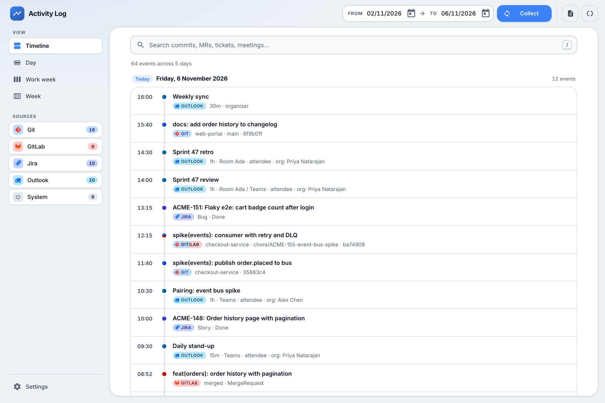
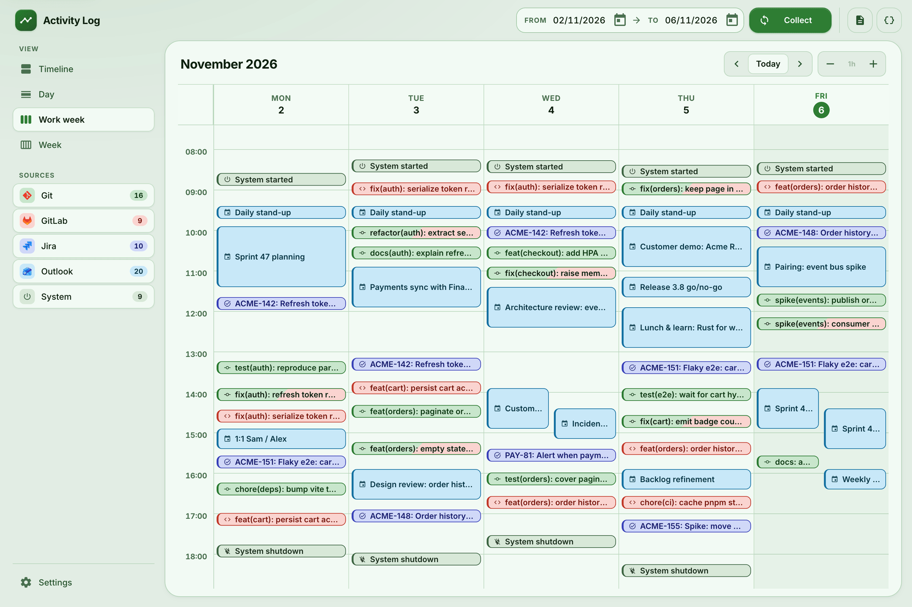
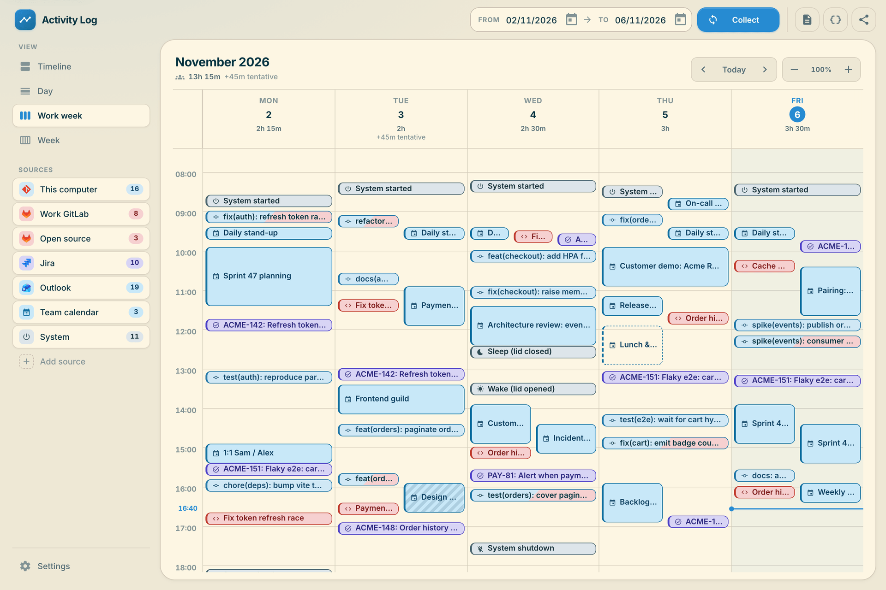
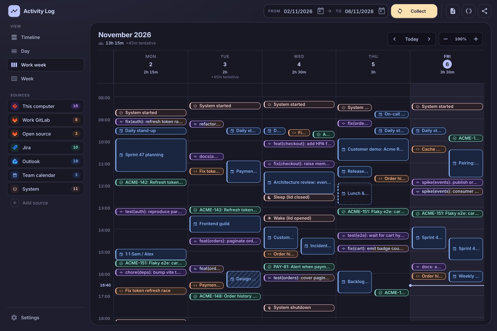
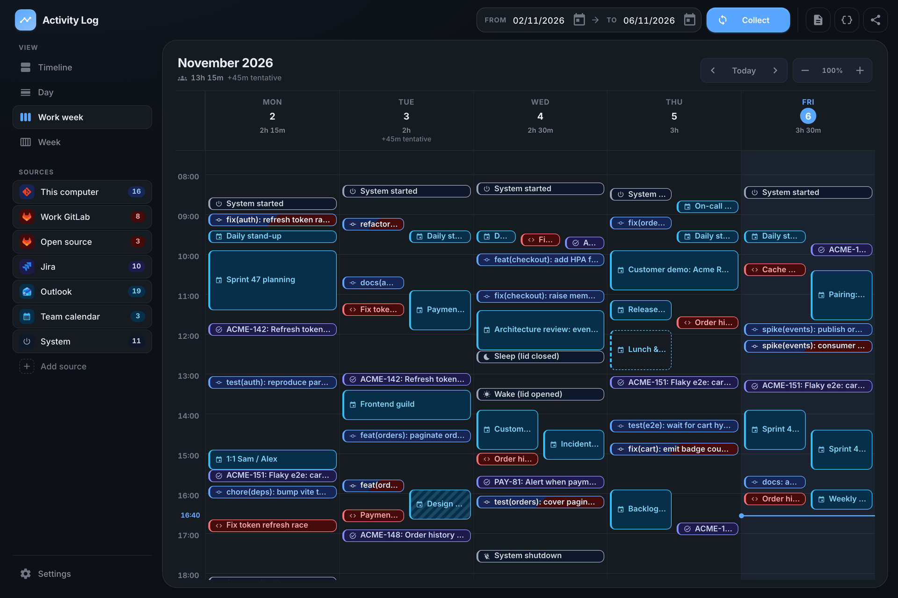
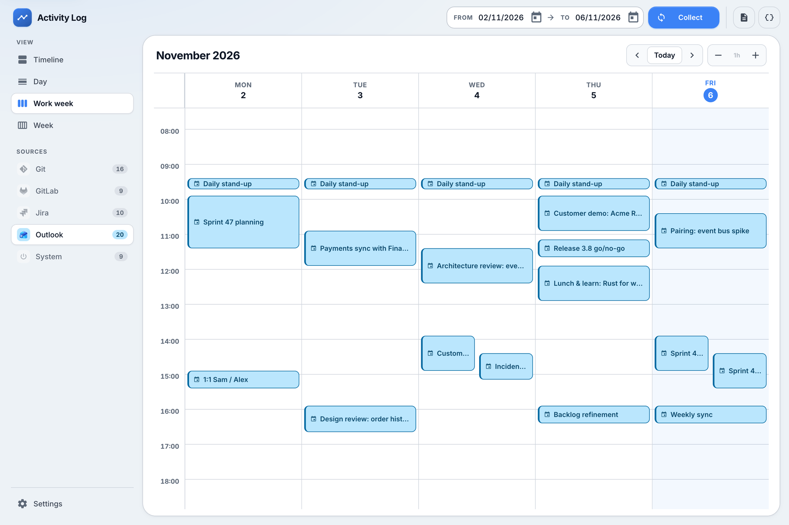
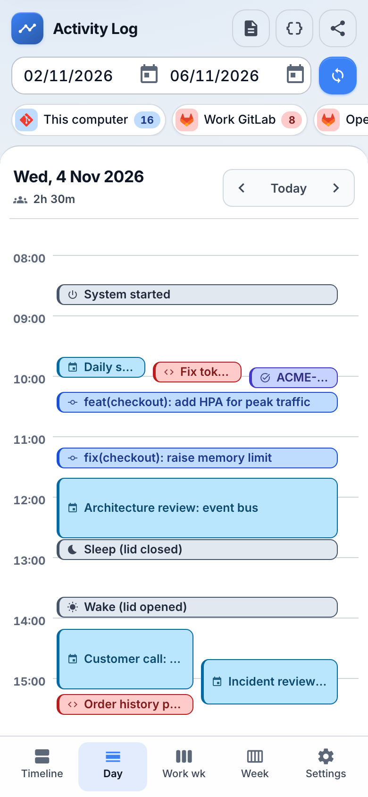
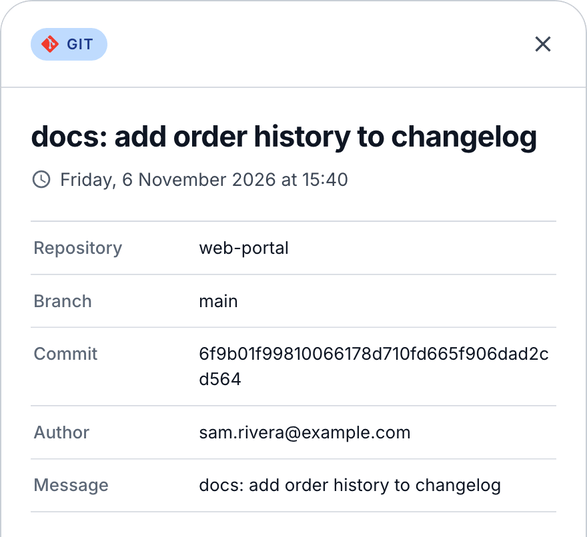
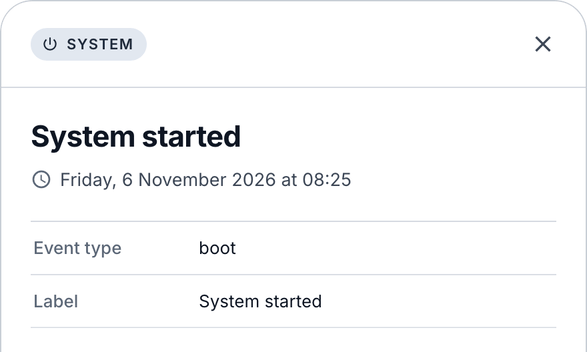

<p align="center">
  
</p>

<h1 align="center">Activity Log</h1>

<p align="center">
  A unified activity tracker that aggregates everything you did into a single timeline — commits, GitLab events, Jira issues, calendar meetings, and system events.
</p>

<p align="center">
  <a href="#data-sources">Data sources</a> ·
  <a href="#features">Features</a> ·
  <a href="#sources-in-detail">Sources in detail</a> ·
  <a href="#getting-started">Getting started</a> ·
  <a href="#configuration">Configuration</a> ·
  <a href="#development">Development</a>
</p>

<p align="center">
  
</p>

<p align="center"><sub>Work week view. All screenshots use demo data.</sub></p>

## Data sources

| Source       | What it collects                                                                   |
| ------------ | ---------------------------------------------------------------------------------- |
| **Git**      | Commits from local repositories via an embedded Git library                        |
| **GitLab**   | MRs, pushes, comments, reviews                                                     |
| **Jira**     | Issues assigned to or reported by you                                              |
| **Outlook**  | Calendar events from the running Outlook desktop app via native desktop APIs       |
| **System**   | Boot and shutdown events from the Windows Event Log and the macOS session history  |
| **Calendar** | Events from published ICS calendar links (Outlook, Google, iCloud) or `.ics` files |

A new install has no sources: add the ones you use with **Add source**. Git, GitLab, Jira and Calendar can be added more than once: two GitLab accounts, two Jira sites, Git on this computer and in each WSL distribution, several calendars. Each connection has its own label, settings, startup check and filter chip. The window opens without waiting for the checks or the first collection: each source shows a spinner until it is checked and collected, and its entries appear as soon as they are in, without waiting for the slowest source.

When a local git commit matches a GitLab push event (same commit SHA), they are merged into a single **git/lab** entry instead of appearing twice.

The entry types, displayed fields, supported platforms and configuration of each source are listed under [Sources in detail](#sources-in-detail).

## Features

### Four views

The sidebar switches between **Timeline** (a list grouped by day, newest day first), **Day**, **Work week** (Monday to Friday) and **Week** (Monday to Sunday). The three calendar views have previous, Today and next buttons and a zoom control.

When the Timeline list is longer than the window, a day index runs down its right edge with one row for every day of the selected range, newest at the top. The highlighted day follows the day header stuck at the top of the list. Hovering shows the day and its event count, and clicking or dragging jumps to that day; a day without events jumps to the nearest day that has some. Long ranges show Monday labels only or, past a few months, one bar per day sized by its event count. From the keyboard it is the next stop after the search box: <kbd>↑</kbd> <kbd>↓</kbd> step between days with events, <kbd>Page Up</kbd> <kbd>Page Down</kbd> move a week, <kbd>Home</kbd> <kbd>End</kbd> go to the newest and oldest day, and <kbd>Enter</kbd> moves focus to that day's first event.

<table>
  <tr>
    <td width="50%"><br><sub>Timeline</sub></td>
    <td width="50%"><br><sub>Day</sub></td>
  </tr>
  <tr>
    <td width="50%"><br><sub>Work week</sub></td>
    <td width="50%"><br><sub>Week</sub></td>
  </tr>
</table>

### Themes

**Settings → General** has a theme picker with eight themes: Light, Green, Lilac, Solarized, Dim, Mocha, Dark and Midnight. The selected theme is stored in the browser's local storage.

<p align="center">
  
</p>

<table>
  <tr>
    <td width="25%"><br><sub>Light</sub></td>
    <td width="25%"><br><sub>Green</sub></td>
    <td width="25%"><br><sub>Lilac</sub></td>
    <td width="25%"><br><sub>Solarized</sub></td>
  </tr>
  <tr>
    <td width="25%"><br><sub>Dim</sub></td>
    <td width="25%"><br><sub>Mocha</sub></td>
    <td width="25%"><br><sub>Dark</sub></td>
    <td width="25%"><br><sub>Midnight</sub></td>
  </tr>
</table>

### Search

The Timeline view has a search box that filters the entries as you type, ignoring case. <kbd>/</kbd> focuses it and <kbd>Esc</kbd> clears it. It matches fields such as commit message, repository, branch, GitLab event title, Jira key and status, and meeting title, location and organizer.

<p align="center">
  
</p>

### Source filter

Every connection has a chip with its label, such as "Work GitLab" or "WSL · NixOS", and its entry count. Click a chip to toggle that source. Double-click it to show only that source, and double-click it again to show all sources.

<p align="center">
  
</p>

<p align="center"><sub>Work week after double-clicking the Outlook chip.</sub></p>

### Entry details

Clicking an entry in any view opens a panel with the fields collected for it. The fields of each source are listed under [Sources in detail](#sources-in-detail).

<p align="center">
  
</p>

### git/lab merge

A local commit whose SHA matches a GitLab push event is shown once, with a **git/lab** badge. Its detail panel lists the Git fields and the GitLab fields in separate sections.

<p align="center">
  
</p>

### Export

The two buttons in the header export the current filtered view (date range, active sources and, in the Timeline view, the search query) as Markdown grouped by day or as JSON. The browser downloads the file as `activity-<from>-<to>.md` or `.json`; the desktop app opens a native save dialog instead.

Start of the Markdown export of the demo data:

```markdown
# Activity Summary - 2026-11-02 to 2026-11-06

Total: 64 events

## Friday, 6 November 2026

- **[outlook]** Weekly sync (16:00 · 30m)
- **[git]** `web-portal` docs: add order history to changelog (15:40)
- **[outlook]** Sprint 47 retro @ Room Ada (14:30 · 1h)
- **[outlook]** Sprint 47 review @ Room Ada / Teams (14:00 · 1h)
- **[jira]** ACME-151: Flaky e2e: cart badge count after login [Done] (13:15)
- **[git]** `checkout-service` spike(events): consumer with retry and DLQ (12:15)
```

### Source settings and startup status

**Settings** lists every connection with the result of its startup check and the operating systems it supports. In the desktop app, each pane also has the connection's settings, its **Label** and **Remove source**. Secret fields are write-only and only show whether a value is set.

**Add source** (in the sidebar, in Settings, and on the empty dashboard before the first source) shows a tile per source with what it collects. A tile adds the source and opens its settings; for Git on Windows it first asks for this computer or an installed WSL distribution. Outlook and System can be added once, and a source that does not run on this operating system is shown but disabled. GitHub, Microsoft Teams, Figma, Miro and Odoo are listed as coming soon.

<p align="center">
  
</p>

### Logs

**Settings → Logs** shows the in-memory diagnostic log of provider checks, collection runs and settings saves. It can be filtered to warnings or errors, copied and cleared.

<p align="center">
  
</p>

### Phone-width layout

At a width of 640px or less, the view switcher and Settings move to a bottom tab bar and the source chips become a horizontally scrolling row.

<table align="center">
  <tr>
    <td align="center"><br><sub>Timeline (Mocha)</sub></td>
    <td align="center"><br><sub>Day (Light)</sub></td>
  </tr>
</table>

### Per-day cache

GitLab and Jira results are cached on disk per day, so a collection only requests the days that are missing or stale. The Logs pane records what was fetched and what was served from cache. TTLs and the cache location are described under [Configuration](#configuration).

### CLI

`pnpm cli:collect` runs a collection without the dashboard and writes JSON (the default) or Markdown to a file. All flags are listed in the CLI reference under [Development](#development).

```bash
pnpm cli:collect --range week
pnpm cli:collect --range week --format markdown --output reports/week.md
```

## Sources in detail

For each source, this section lists the entries it produces, the line shown under the entry title in the Timeline view, and the fields of the detail panel. A field without a value is left out of the panel. The calendar views show the entry title only. The panels below show demo data.

### Git

<table>
<tr>
<td width="56%" valign="top">

- **Entries:** one per commit authored with one of your emails, read from all refs of each repository. Your emails are every `user.email` found in any Git connection: in each repository's config (including the global one) and in each WSL distribution's global config. Emails compare case-insensitively, so a repository without `user.email` still contributes commits made with an email configured elsewhere. The title is the commit subject.
- **Timeline line:** repository · branch · first 7 characters of the commit hash
- **Detail panel:** Repository (folder name), Branch, Commit (full hash), Author (email), Message
- **Branch:** only set for the commit that is the checked-out `HEAD` of its repository. Other commits have no branch.
- **Merged entries:** a commit that matches a GitLab push event becomes a [git/lab entry](#gitlab-merge) with an additional GitLab section.
- **Platforms:** Windows, macOS, Linux
- **Configuration:** `dirs` (optional list) per Git connection. A listed folder that contains `.git` is used as a repository; any other folder is searched for repositories up to four levels deep. Unset means the home folder. Repositories are only skipped when no `user.email` is configured anywhere. Worktrees of one repository are read once, under the name of its main folder, and a commit that several clones or Git sources hold is listed once.
- **Locations:** each Git connection reads one place: this computer, or (Windows) a WSL distribution. Without configuration there is one connection for this computer and, on Windows, one per registered distribution searching its `~`; Docker, Rancher and Podman distributions are skipped. Removing a distribution's connection excludes it.
- **WSL (Windows):** repositories inside WSL are read by running `git` in the distribution (`wsl.exe -d <distro>`), not over `\\wsl.localhost` paths, which is faster and avoids Git's ownership check. Folders are Linux paths; `~` stands for the distribution's home.

</td>
<td width="44%" valign="top"></td>
</tr>
</table>

### GitLab

<table>
<tr>
<td width="56%" valign="top">

- **Entries:** one per event in the GitLab event feed of `GITLAB_USER`. The title is the title of the event's target, for example the merge request title. An event without a target title shows its action as the title.
- **Actions:** `pushedTo`, `created`, `opened`, `closed`, `reopened`, `updated`, `merged`, `accepted`, `commentedOn`, `approved`, `joined`, `destroyed` and `expired`. Any other action is stored as `unknown`.
- **Timeline line:** action · target type as reported by GitLab, for example `merged · MergeRequest` or `commentedOn · DiffNote`
- **Detail panel:** Action, Title and Target type. MR (`!` and the target IID) when the event has one. Branch and Commits for push events. File, Comment and Resolved for comments.
- **Merged entries:** a push event whose commit SHA matches a local commit is shown inside that commit's [git/lab entry](#gitlab-merge) instead of as its own entry.
- **Platforms:** Windows, macOS, Linux
- **Configuration:** `url`, `token` and `user` (all required). Results use the [per-day cache](#per-day-cache).

</td>
<td width="44%" valign="top"></td>
</tr>
</table>

### Jira

<table>
<tr>
<td width="56%" valign="top">

- **Entries:** taken from issues assigned to or reported by you. The title is the issue key followed by the summary.
  - `issueCreated`: the issue was created in the date range.
  - `statusChanged`: one entry per status change in the date range.
  - `issueUpdated`: the issue was updated in the date range without a status change in that range.
- **Timeline line:** issue type · status
- **Detail panel:** Event, Key, Title, Status and Issue type. From status and To status for status changes.
- **Platforms:** Windows, macOS, Linux
- **Configuration:** `url` and `token` (required), `insecure` (optional). Results use the [per-day cache](#per-day-cache).

</td>
<td width="44%" valign="top"></td>
</tr>
</table>

### Outlook

<table>
<tr>
<td width="56%" valign="top">

- **Entries:** one per event in Outlook's default calendar that overlaps the date range. The title is the event subject.
- **Timeline line:** duration · location · `organizer` or `attendee` · `org:` and the organizer's name when you are not the organizer
- **Detail panel:** Title, Duration, Location, Organizer and Role (Organizer or Attendee)
- **Calendar views:** a meeting is drawn as a block that spans its duration.
- **Platforms:** Windows, macOS
- **Configuration:** none. Outlook has to be installed and running. On Windows this must be classic Outlook: the new Outlook has no interface for other apps, and Activity Log cannot reach Outlook while it runs as administrator. On macOS it also needs a signed-in Exchange account. With the new Outlook, publish the calendar and add its ICS link as a [Calendar](#calendar) source.

</td>
<td width="44%" valign="top"></td>
</tr>
</table>

### Calendar

- **Entries:** one per event occurrence in the feed that overlaps the date range. Recurring meetings are expanded, with moved and removed occurrences applied. All-day and cancelled events are left out. The title is the event summary.
- **Timeline line:** duration · location · `org:` and the organizer's name
- **Detail panel:** Title, Duration, Location, Organizer
- **Calendar views:** a meeting is drawn as a block that spans its duration.
- **Platforms:** Windows, macOS, Linux
- **Configuration:** `ics_url` (required) per calendar: an `https://` or `webcal://` link, or the path of an `.ics` file. Plain `http://` is refused. The link is stored like a token and never written to the logs. Times without a time zone are read in this computer's time zone.
- **Outlook (also the new Outlook):** Settings → Calendar → Shared calendars → Publish a calendar, then copy the ICS link. The tenant may only allow availability without titles. Anyone who has the link can read the calendar; unpublishing revokes it.

### System

<table>
<tr>
<td width="56%" valign="top">

- **Entries on Windows:** System event log events 6005 (`boot`, "System started"), 6006 (`shutdown`, "System shutdown") and 6008 (`unexpected_shutdown`, "Unexpected shutdown").
- **Entries on macOS:** the reboot and shutdown records of the `last` command, as `boot` ("System started") and `shutdown` ("System shutdown").
- **Timeline line:** the event type
- **Detail panel:** Event type and Label
- **Platforms:** Windows, macOS
- **Configuration:** none

</td>
<td width="44%" valign="top"></td>
</tr>
</table>

## Getting started

### Requirements

- Rust toolchain (`cargo`, `rustc`)
- [Node.js](https://nodejs.org) `^22.22.3`, `^24.15.0` or `>= 26` (Angular 22 requirement)
- [pnpm](https://pnpm.io) >= 10
- Windows or macOS for the local Outlook and System collectors

### Setup

```bash
git clone https://github.com/wiwiwi-inc-tm/activity-log.git
cd activity-log
pnpm install
pnpm cli:collect sources add gitlab   # or add sources in the desktop app
```

### Run

| What                | Command                         | Result                                                               |
| ------------------- | ------------------------------- | -------------------------------------------------------------------- |
| Web dashboard + API | `pnpm dev`                      | API on `http://localhost:3001`, dashboard on `http://localhost:4200` |
| Desktop app (Tauri) | `pnpm desktop:dev`              | The same Angular UI in a desktop window, talking to Rust commands    |
| CLI                 | `pnpm cli:collect --range week` | Writes `logs/activity_log.json` (`--format markdown` writes a `.md`) |

The last 30 days are collected automatically on startup. Use the date pickers in the header to change the range and re-collect on the fly.

## Configuration

### Config file

The CLI, the API server and the desktop app share one file: `activity-log/config.toml` in the OS config folder (`%APPDATA%` on Windows, `~/Library/Application Support` on macOS, `$XDG_CONFIG_HOME` or `~/.config` on Linux). `ACTIVITY_LOG_CONFIG` or `--config <path>` (CLI and API server) points elsewhere. `activity-log config path` prints it.

Each connection is a table in the list of its kind. Field names are the setting names without the kind prefix (`GITLAB_URL` → `url`):

```toml
[[gitlab]]
label = "Work GitLab"
url = "https://gitlab.example.com"
token = "glpat-…"
user = "me"

[[gitlab]]
name = "oss"
label = "Open source"
url = "https://gitlab.com"
token = "glpat-…"
user = "me"

[[git]]
label = "This computer"
dirs = ["~/Projects"]

[[git]]
label = "WSL · NixOS"
wsl = "NixOS"
dirs = ["~", "/srv/tools"]

[[calendar]]
label = "Team"
ics_url = "https://outlook.office365.com/owa/calendar/…/calendar.ics"
```

- The file is the only list of sources: a kind it does not mention is not collected. An empty or missing file means no sources.
- A connection is identified by its kind and `name`, such as `gitlab/oss`. Without `name`, the name comes from the label (`Work GitLab` → `work-gitlab`). The name never changes with the label.
- Without `label`, a connection is named after its kind (`GitLab`), or for Git after its location (`This computer`, `WSL · NixOS`).
- `[[outlook]]` and `[[system]]` have no settings; the empty table adds them.
- The file holds tokens. It is written readable only by your user on macOS and Linux.
- The desktop app and the CLI edit it in place and keep comments. The API server reloads it when it changes.

### Environment variables

Sources are set up only in the [config file](#config-file). These variables (also read from `.env`) change where files live and how the server runs:

| Variable                 | Description                                                                         |
| ------------------------ | ----------------------------------------------------------------------------------- |
| `ACTIVITY_LOG_CONFIG`    | Path of the config file                                                             |
| `PORT`                   | API server port (default: `3000`; `pnpm dev`/`pnpm api:dev` use `3001`)             |
| `CACHE_TTL_MINUTES`      | How long today's and other recent cached GitLab/Jira days stay fresh (default: `5`) |
| `ACTIVITY_LOG_CACHE_DIR` | Override the per-day cache directory (default: the OS cache dir)                    |

Git history is read in-process. The `git` command is only asked for `user.email` when the config files the library reads have none (some Windows setups keep the global config elsewhere). Outlook and System collectors need no credentials: they read from the local Outlook app and the platform's native event and session history APIs. Outlook is never started by the app: its calendar is collected only while Outlook is already open.

<details>
<summary><b>Per-day cache</b></summary>

<br>

GitLab and Jira opt into a per-day disk cache. Each collection serves the days it already has and fetches only missing or stale days. Today, yesterday and any day fetched before it ended stay fresh for `CACHE_TTL_MINUTES`. Days fetched more than an hour after they ended are "settled" and stay fresh for 7 days. Files live under `activity-log/cache` in the OS cache directory (`%LOCALAPPDATA%` on Windows, `~/Library/Caches` on macOS, `$XDG_CACHE_HOME` or `~/.cache` on Linux) unless `ACTIVITY_LOG_CACHE_DIR` is set.

</details>

<details>
<summary><b>Desktop dynamic provider settings</b></summary>

<br>

In the desktop app, provider configuration fields are generated from Rust provider `config_requirements()` metadata and rendered dynamically in the Settings dialog.

- Scope: desktop (Tauri) only. In the web dashboard the source panes show status but not editable settings.
- Storage: `config.toml`, shared with the CLI and the API server.
- Secret fields: values are write-only in UI/API; the frontend only receives `isSet`.
- Runtime behavior: save operations rebuild provider runtime config and refresh startup status.
- Lists: `GIT_DIRS` is edited as rows and stored as a TOML array. An unset list shows its default (your home directory, or `~` in WSL); **Use default** returns to it, and removing every row saves an empty list, which means none.
- Connections: **Add source** adds a connection with a default label; GitLab, Jira, Calendar and Git can have several, Outlook and System one. For Git on Windows it offers this computer or an installed WSL distribution. Every connection can be renamed and removed.

</details>

## Development

The backend is a Rust workspace and the frontend is an Angular app:

| Part         | Role                                                                                |
| ------------ | ----------------------------------------------------------------------------------- |
| `core`       | Shared DTOs, collectors, cache, merge logic, markdown export, and TS generation     |
| `api`        | Rocket API                                                                          |
| `cli`        | Standalone collection CLI and a separate TypeScript generator binary for Angular    |
| `desktop/`   | Packages the Angular UI as a Tauri desktop app that talks to Rust commands directly |
| `dashboard/` | The Angular app. It consumes generated DTOs from `dashboard/src/app/generated/`     |

### Verification

Run this before treating changes as done:

```bash
pnpm verify
```

`verify` is the repo-wide gate. It runs TypeScript generation, formatter checks, Rust checks, clippy, Rust tests, dashboard lint, dashboard tests, Angular type-checking, and the dashboard build.

For Windows-specific backend coverage that also runs on macOS/Linux, use:

```bash
pnpm core:test:windows
```

That script exercises host-runnable Windows logic such as provider metadata, event-log query generation, XML parsing, and event mapping. For a full Windows-target compile (including the desktop crate), run `nix develop .#windows -c pnpm win:check`. See [`docs/testing-windows-on-mac.md`](docs/testing-windows-on-mac.md) for the full Windows testing strategy.

### Reference

<details>
<summary><b>Web dashboard + API</b></summary>

<br>

Hot-reload development (recommended):

```bash
pnpm dev
# API server  → http://localhost:3001
# Dashboard   → http://localhost:4200  (live reload, /api proxied to :3001)
```

Or run the two halves in separate terminals:

```bash
pnpm api:dev          # API on :3001, the port the dashboard dev server proxies to
pnpm dashboard:dev    # dashboard on :4200
```

`pnpm api:start` runs the API on its default port, [http://localhost:3000](http://localhost:3000) (override with `PORT`). The API routes are:

- `GET /api/activity`: the last collection's log. While it runs the answer is `202` with the log of what is in so far: `meta.pending` lists the connections still being checked or collected, and is absent once the log is complete (`200`). After a collection failed as a whole: `200` with `{ "start", "end", "error" }`. Before the first collection: `503`
- `GET /api/providers`: every connection with its startup check result, or `"status": "checking"` while the check still runs
- `POST /api/collect` with `{ "start": "<RFC 3339>", "end": "<RFC 3339>" }`, the range `[start, end)`: starts the collection and answers `202` at once with its first log (no entries, every connection pending), or with the log of the collection that already runs; poll `GET /api/activity` for the result
- `GET /api/logs`, `DELETE /api/logs`

The last 30 days are collected automatically on startup; the date pickers show that range while it runs, and keep it if it fails. The startup checks run in the background: a source is listed as checking until its own check finishes, and a collection reads each source as soon as that source is checked, so a slow check or a slow source holds back only itself. Results are progressive: the dashboard shows each source's entries when they arrive, and while a range is collected again it keeps a source's previous entries until the new ones are in. Saving settings (or editing `config.toml` under a running server) re-runs the checks the same way, and the backend collects its last range again with the new connections. After a change in Settings the dashboard follows that collection by itself; after an edit of the file, the next **Collect** or reload shows the result, including sources that are new. Use them to change the range and re-collect on the fly.

If you only build the dashboard (`pnpm dashboard:build`), it produces static files under `dashboard/dist/dashboard/` and does not serve them. To preview that build, run a static file server (for example `pnpm --dir dashboard exec npx http-server dist/dashboard/browser -p 4200`) or use `pnpm dashboard:dev`.

The header has two export buttons. Both export the current filtered view:

- **Markdown** (`description` icon): downloads a `.md` summary grouped by day
- **JSON** (`data_object` icon): downloads the raw entries as `.json`

In the desktop app, exports open a native save dialog instead.

</details>

<details>
<summary><b>Desktop app (Tauri)</b></summary>

<br>

The desktop app uses the same Angular UI, but swaps the transport layer from HTTP to direct Rust commands when it is running inside Tauri.

```bash
pnpm desktop:dev      # development
pnpm desktop:build    # debug build / packaging
```

**Windows installer from macOS/Linux**

Cross-builds the NSIS installer for `x86_64-pc-windows-msvc` with [cargo-xwin](https://github.com/rust-cross/cargo-xwin) (Microsoft CRT/SDK are downloaded on first run). The `windows` flake shell provides the Rust target, cargo-xwin, LLVM (`clang-cl`, `lld-link`, `llvm-rc`) and NSIS:

```bash
nix develop .#windows -c pnpm desktop:build:windows
```

The installer lands in `target/x86_64-pc-windows-msvc/release/bundle/nsis/`. MSI (WiX) bundles can only be produced on Windows; use the `Desktop Build` workflow for those.

**Regenerate app icons from the Angular favicon**

```bash
pnpm --dir dashboard exec tauri icon src/favicon.svg -o ../desktop/icons
```

This writes the platform icon set into `desktop/icons/`.

</details>

<details>
<summary><b>CLI reference</b></summary>

<br>

No dashboard build needed.

| Flag                | Description                                                               |
| ------------------- | ------------------------------------------------------------------------- |
| `--range <preset>`  | `today`, `yesterday`, `week`, `lastweek`, `month` or `lastmonth`          |
| `--since <date>`    | Start date (`YYYY-MM-DD`). Without `--range`, defaults to 30 days ago     |
| `--until <date>`    | End date (`YYYY-MM-DD`). Without `--range`, defaults to today             |
| `--format <format>` | `json` (default) or `markdown`                                            |
| `--output <path>`   | Output file (default: `logs/activity_log.json` or `logs/activity_log.md`) |
| `--config <path>`   | Config file to read (default: see [Config file](#config-file))            |

```bash
pnpm cli:collect --range today
pnpm cli:collect --range yesterday
pnpm cli:collect --range week
pnpm cli:collect --range lastweek
pnpm cli:collect --range month
pnpm cli:collect --range lastmonth
pnpm cli:collect --since 2026-03-01 --until 2026-03-18
```

Without `--range`, `--since` defaults to 30 days ago and `--until` to today. Dates are whole days in your local time zone.

**Output format**

Default output is JSON. Use `--format markdown` to get a Markdown summary instead:

```bash
pnpm cli:collect --format json            # → logs/activity_log.json  (default)
pnpm cli:collect --format markdown        # → logs/activity_log.md
```

Override the output path with `--output`:

```bash
pnpm cli:collect --range week --output reports/week.json
pnpm cli:collect --range week --format markdown --output reports/week.md
```

`--output` is a CLI-only export setting. It is not part of backend `CollectOptions`.

**Managing sources**

```bash
pnpm cli:collect sources                              # every connection with its status
pnpm cli:collect sources add gitlab                   # asks for url, token (hidden), user
pnpm cli:collect sources add gitlab --label "Work"    # a label of your own; default: the kind's name
pnpm cli:collect sources add git --wsl NixOS          # a Git location inside WSL
pnpm cli:collect sources set gitlab/oss url https://gitlab.com
pnpm cli:collect sources set gitlab/oss token         # asks without echo
pnpm cli:collect sources set git/this-computer dirs ~/Projects ~/work
pnpm cli:collect sources unset git/this-computer dirs # back to the default
pnpm cli:collect sources rename gitlab/oss "Open source"
pnpm cli:collect sources remove gitlab/oss
pnpm cli:collect config edit                          # opens the file in $VISUAL or $EDITOR
```

A connection is named `kind/name`, or by its name alone when that is unique. Values are checked like in the desktop app before the file is written.

</details>

<details>
<summary><b>Generate Angular DTO types</b></summary>

<br>

```bash
pnpm types:generate
```

This writes Rust-backed DTO types into `dashboard/src/app/generated/`. The Rust contract is the source of truth; don't edit the generated files by hand.

</details>

<details>
<summary><b>Dashboard styling rules</b></summary>

<br>

- Use named breakpoints from `dashboard/src/app/components/_dashboard-shared.scss` (for example `@include ui.down('phone')`) instead of raw `@media (max-width: ...)` when a named breakpoint exists.
- Use `var(--content-max-width)` for shared content width caps instead of hardcoded `1120px`.

</details>

<details>
<summary><b>Project structure</b></summary>

<br>

```text
activity-log/
├── core/
│   └── src/
│       ├── collect/           Git, GitLab, Jira, Outlook, System collectors
│       ├── cache/             Per-day disk cache for API providers (GitLab, Jira)
│       ├── diagnostics/       In-memory diagnostic log shown in the Logs pane
│       ├── model/             Shared models grouped by domain/source
│       ├── runtime/           Shared collection runtime used by Rocket and Tauri
│       ├── ts.rs              Angular DTO generator
│       └── utils/             Date utilities, markdown formatter, git/gitlab merge
├── api/                       Rocket API crate
├── cli/                       Rust CLI crate
├── desktop/                   Tauri desktop crate, config, capabilities, and icons
├── dashboard/
│   ├── src/app/
│   │   ├── components/        header, filters, timeline, calendar views, settings dialog
│   │   ├── generated/         Rust-generated DTOs
│   │   ├── services/          app state; backend/ holds the operation table and HTTP/Tauri transports
│   │   ├── models/            Angular-only view models
│   │   └── utils/             Angular-only helper logic
├── pics/                      README screenshots (demo data)
├── logs/                      Generated output (gitignored)
├── Cargo.toml
├── .env.example
├── package.json
└── README.md
```

</details>
