<p align="center">
  
</p>

<h1 align="center">Activity Log</h1>

<p align="center">
  A local activity timeline for developers. Collects your Git commits, GitLab events, Jira Data Center issues, calendar meetings, and system sessions into one private desktop app, web dashboard, or CLI report.
</p>

<p align="center">
  <a href="#why-activity-log">Why Activity Log</a> ·
  <a href="#getting-started">Getting started</a> ·
  <a href="#features">Features</a> ·
  <a href="#sources-in-detail">Sources</a> ·
  <a href="#configuration">Configuration</a> ·
  <a href="#cli">CLI</a> ·
  <a href="#api">API</a> ·
  <a href="#development">Development</a>
</p>

<p align="center">
  
</p>

<p align="center"><sub>Work week view. All screenshots use demo data.</sub></p>

## Why Activity Log

Reconstructing a week of work usually means hopping across Git logs, GitLab, Jira, and calendar apps. Activity Log puts all of it in one place without sending your history to a third party.

- **One timeline across six sources.** Combines local Git commits, GitLab activity, Jira Data Center issues, Outlook meetings, ICS calendar feeds, and OS boot/sleep history. Matching local Git commits and GitLab push events merge into a single **git/lab** entry instead of showing up twice.
- **Local and private.** Everything runs on your machine. Nothing leaves your computer except requests to the servers you configure. Your config file and per-day cache are written as owner-only files.
- **Fast and live.** The app opens immediately without blocking on slow servers. Provider startup checks run in the background, entries stream in live as each source finishes, and remote API sources cache completed days on disk.
- **Desktop app, web dashboard, or CLI.** Run the Tauri desktop app on macOS, Windows, or Linux, use the browser dashboard against the local Rocket API, or export Markdown and JSON straight from the command line.

## Getting started

> **Note:** There is no packaged release yet. Build and run Activity Log from source.

### Requirements

- Rust toolchain (`cargo`, `rustc`)
- [Node.js](https://nodejs.org) `^22.22.3`, `^24.15.0`, or `>= 26`
- [pnpm](https://pnpm.io) `>= 10`
- Windows or macOS for the local Outlook and System sources
- Optional: [Nix](https://nixos.org) (`nix develop` provides the toolchain)

### Setup

```bash
git clone https://github.com/teo-zaha/activity-log.git
cd activity-log
pnpm install
```

A new install starts with no sources. Add them from **Add source** in the desktop app, or from the CLI:

```bash
pnpm cli:collect sources add git
pnpm cli:collect sources add gitlab
```

### Run

| Mode                | Command                         | What it starts                                                       |
| ------------------- | ------------------------------- | -------------------------------------------------------------------- |
| Desktop app (Tauri) | `pnpm desktop:dev`              | Angular UI in a desktop window backed directly by Rust commands      |
| Web dashboard + API | `pnpm dev`                      | Rocket API on `http://localhost:3001`, Angular app on `:3200`        |
| CLI                 | `pnpm cli:collect --range week` | Writes `logs/activity_log.json` (`--format markdown` writes a `.md`) |

On startup, Activity Log collects the last 30 days automatically. Change the date range in the header at any time to run a new collection; typed dates are parsed day-first (`03/05/2026` is 3 May).

## Features

### Desktop app and live updates

The Tauri desktop app runs on macOS, Windows, and Linux using the same Angular interface as the web dashboard:

- **Platform chrome:** macOS uses an overlay title bar with traffic lights over the header; Windows uses a frameless window with custom caption buttons and Windows 11 snap layouts over the maximize button.
- **Window state:** Reopens at your last size, position, maximized, or fullscreen state.
- **Context menu:** Suppresses the default web view right-click menu except inside text fields and over selected text.
- **macOS menu bar:** The app's commands (Collect, Export, Copy Link, Filter Activity, the views, Back, Settings, and Keyboard Shortcuts) sit in the menu bar with their shortcuts, next to the standard macOS items; items grey out when they do not apply, and the current view is checked.
- **Notification when a long collection ends:** When a collection that took 20 seconds or more finishes or fails while the window is in the background, the desktop app shows a system notification. Stopped collections show none.
- **Live updates without polling:** Both the desktop app (via Tauri events) and the web dashboard (via server-sent events on `GET /api/events`) receive source status and collection updates as they happen, including edits made to `config.toml` outside the app.

### Four views

Switch between **Timeline** (newest day first), **Day**, **Work week** (Monday–Friday), and **Week** (Monday–Sunday). The three calendar views provide previous, Today, and next controls plus vertical zoom.

- **Meeting time:** Calendar views sum Outlook and Calendar meeting durations per local day and per shown week. Overlapping meetings count once, overnight meetings split across both days, and only visible sources are counted. Busy, working-elsewhere, and unspecified meetings count as busy; tentative time appears separately (`5h 30m · +1h tentative`) excluding overlap with busy meetings; free and out-of-office meetings count as zero.
- **Busy status and current time:** Tentative meetings render hatched and free meetings outlined in calendar views (and tagged in Timeline). A live accent line marks the current time across today's column and updates every minute.
- **Adaptive Timeline index:** When Timeline overflows and spans at least two days with events, an index rail runs along its right edge from the newest day with events to the oldest (including empty days between them). As the span grows, the rail adapts from day numbers to Monday labels, event-count bars, and finally month, quarter, or year rows. Click or drag to jump; from the keyboard, <kbd>↑</kbd>/<kbd>↓</kbd> step between days with events, <kbd>Page Up</kbd>/<kbd>Page Down</kbd> jump a week on day rails or a month on month rails, <kbd>Home</kbd>/<kbd>End</kbd> jump to the ends, and <kbd>Enter</kbd> focuses that day's first event.

<table>
  <tr>
    <td width="50%"><br><sub>Timeline</sub></td>
    <td width="50%">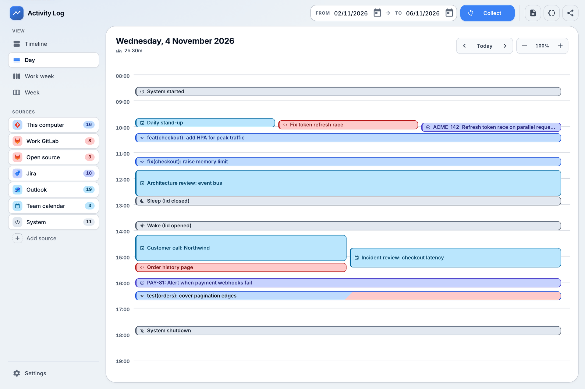<br><sub>Day</sub></td>
  </tr>
  <tr>
    <td width="50%"><br><sub>Work week</sub></td>
    <td width="50%"><br><sub>Week</sub></td>
  </tr>
</table>

### Filtering, source chips, and entry details

- **Instant filter:** Type in **Filter activity…** on Timeline (<kbd>/</kbd> to focus, <kbd>Esc</kbd> to clear) to match case-insensitively across commit messages, repositories, branches, GitLab titles and comments, Jira keys and statuses, and meeting titles, locations, organizers, and descriptions.
- **Source chips:** Every connection gets a chip with its label and entry count. Click to toggle a connection; double-click to isolate it, and double-click again to restore all sources.
- **Entry details and git/lab merge:** Click any entry to open its detail panel. When a local Git commit SHA matches a GitLab push event, Activity Log folds them into one **git/lab** entry whose detail panel shows separate Git and GitLab sections.

<p align="center">
  
</p>

<p align="center">
  
</p>

<p align="center"><sub>Work week after double-clicking the Outlook chip.</sub></p>

<table>
  <tr>
    <td width="50%">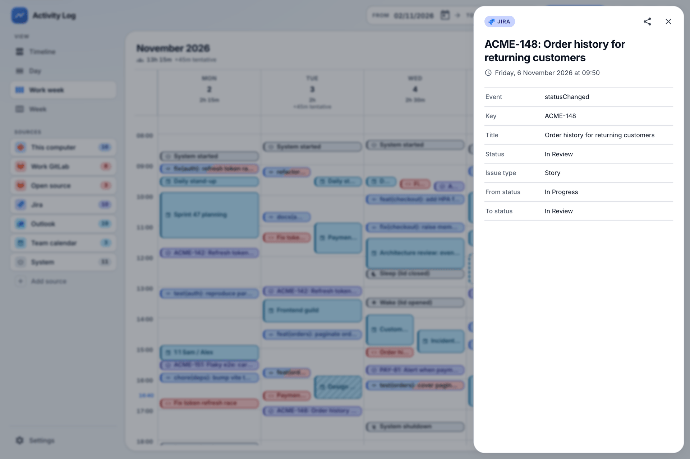<br><sub>Entry detail panel</sub></td>
    <td width="50%">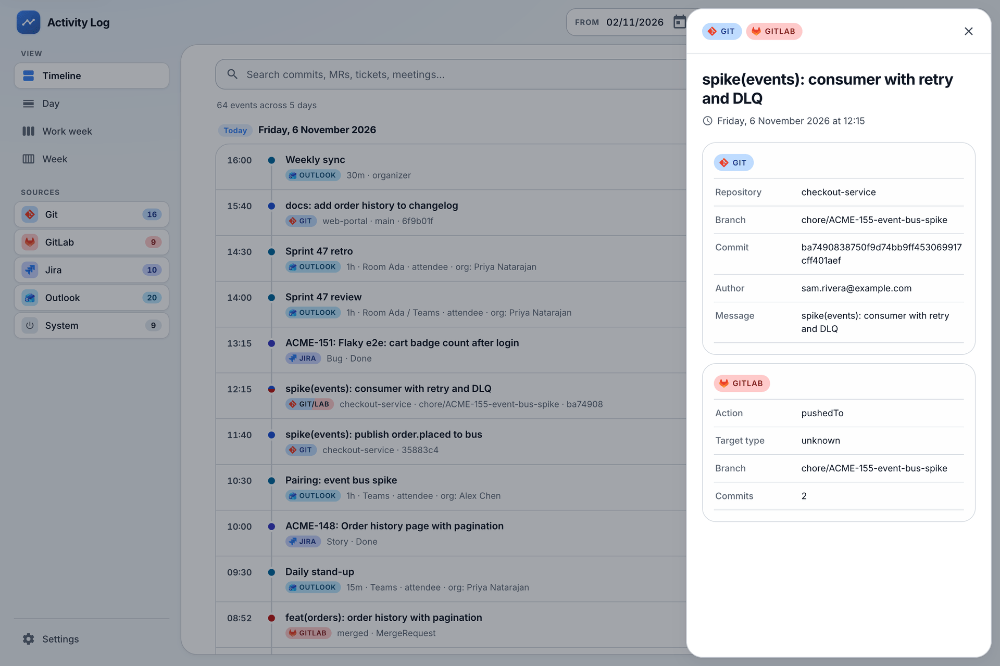<br><sub>Merged git/lab detail panel</sub></td>
  </tr>
</table>

### Multiple connections, startup checks, and Settings

Add Git, GitLab, Jira, and Calendar as many times as you need—for example, two GitLab servers, multiple Jira instances, local Git alongside WSL distributions, or separate calendars. Outlook and System support one connection each.

- **Typed startup checks:** Each connection runs a non-invasive startup check in the background. When a check or collection fails, Settings names the specific problem (such as access refused, server unreachable, timed out, not installed, not running, permission needed, or nothing to read) and offers **Check again** whenever re-checking can resolve it.
- **In-app editing with conflict handling:** In the desktop app, every connection has its own Settings pane with live backend validation, write-only secret fields, rename, and remove. If another tool (such as the CLI) edits `config.toml` while you have unsaved changes, Settings detects the conflict, shows what changed on disk, and lets you keep your changes or discard them. In the web dashboard, Settings shows connection status as read-only.
- **Diagnostics:** **Settings → Logs** displays the in-memory log of startup checks, collection runs, cache hits, and config saves, with warning/error filters, copy, and clear.

<table>
  <tr>
    <td width="50%">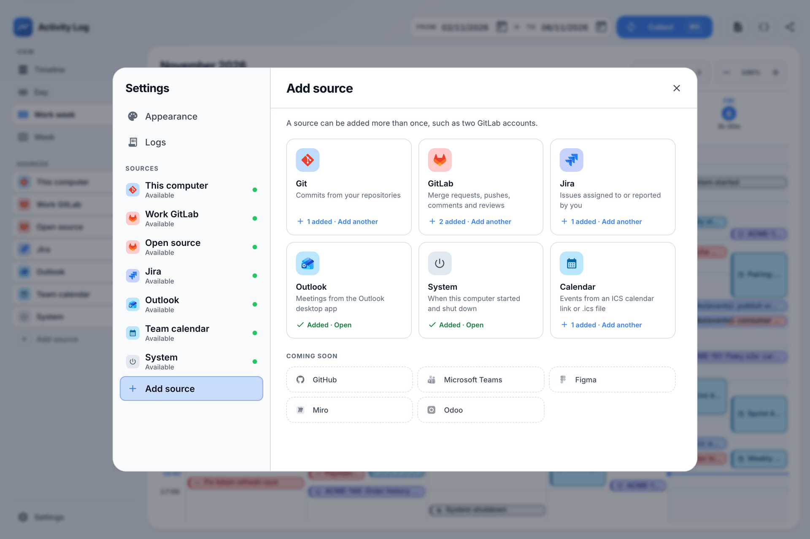<br><sub>Add source (desktop app)</sub></td>
    <td width="50%">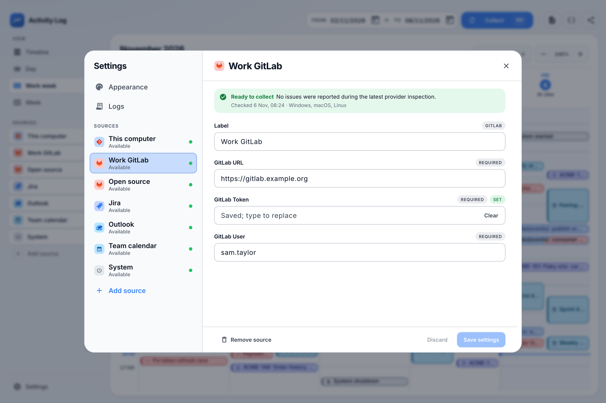<br><sub>Source settings and startup check</sub></td>
  </tr>
</table>

<p align="center">
  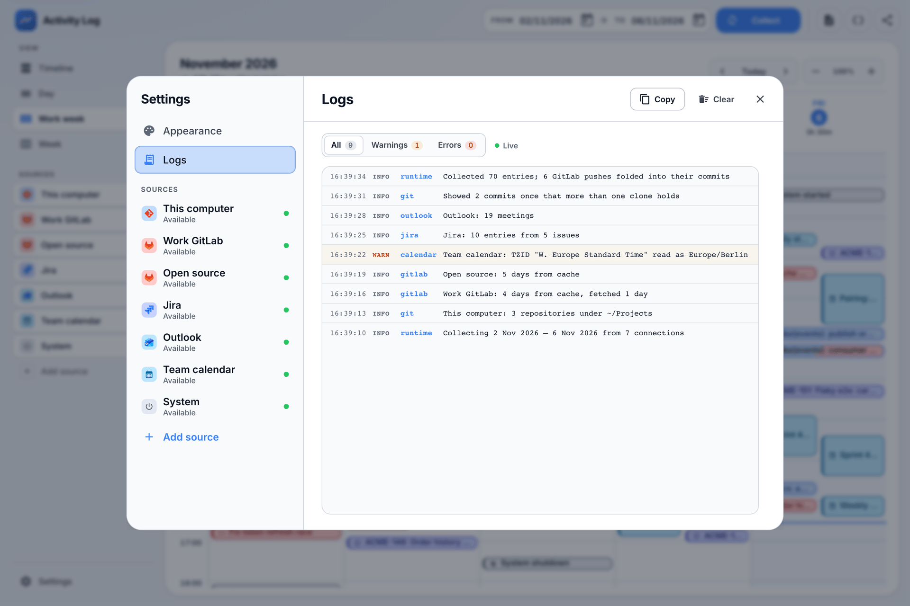
</p>

### Themes and phone layout

**Settings → General** includes eight themes: Light, Green, Lilac, Solarized, Dim, Mocha, Dark, and Midnight. Until you pick one, Activity Log follows your system light or dark preference automatically.

At widths of 640 px or less, navigation and Settings move to a bottom tab bar, source chips scroll horizontally, and event details and Settings sections open as full-screen sliding pages (disabled under reduced motion). Touch support respects screen safe areas, prevents tap flash and accidental zoom on form fields, and applies hover styles only to hovering pointers. On a touch screen, at any width, pulling Timeline down from the top collects the date range on screen again, as **Collect** does; a mouse, trackpad, or wheel never triggers it, and it is off while a collection runs or while details or Settings cover Timeline.

<p align="center">
  
</p>

<table>
  <tr>
    <td width="25%"><br><sub>Light</sub></td>
    <td width="25%"><br><sub>Green</sub></td>
    <td width="25%">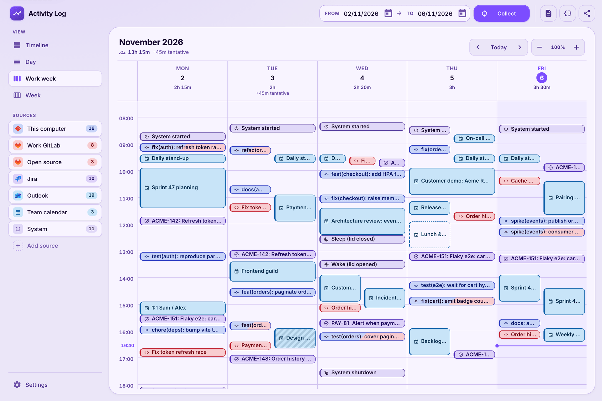<br><sub>Lilac</sub></td>
    <td width="25%"><br><sub>Solarized</sub></td>
  </tr>
  <tr>
    <td width="25%"><br><sub>Dim</sub></td>
    <td width="25%"><br><sub>Mocha</sub></td>
    <td width="25%"><br><sub>Dark</sub></td>
    <td width="25%">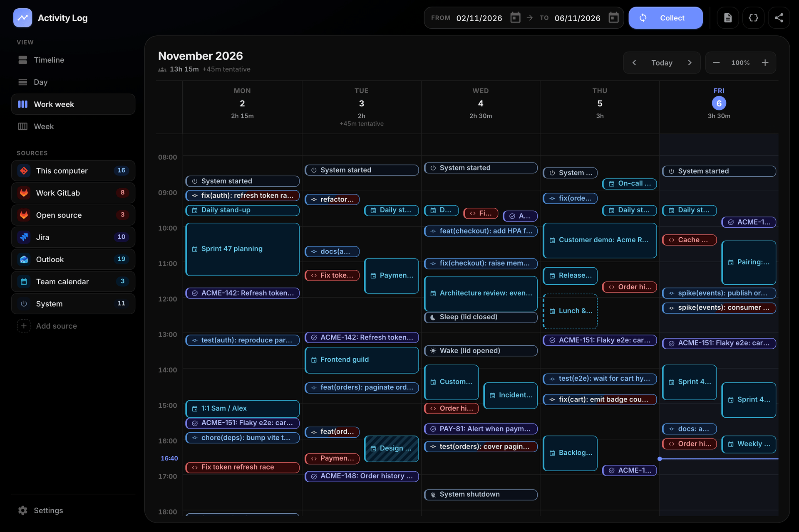<br><sub>Midnight</sub></td>
  </tr>
</table>

<table align="center">
  <tr>
    <td align="center"><br><sub>Timeline (Mocha)</sub></td>
    <td align="center"><br><sub>Day (Light)</sub></td>
    <td align="center">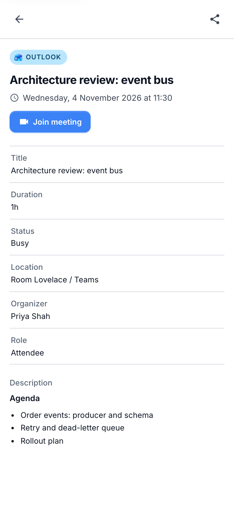<br><sub>Event details</sub></td>
    <td align="center">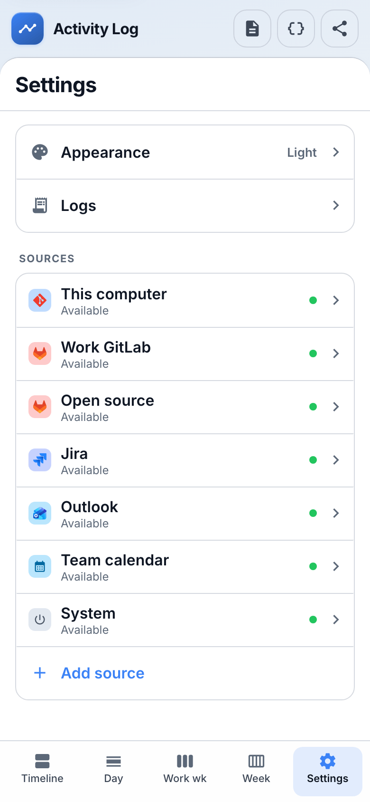<br><sub>Settings tab</sub></td>
  </tr>
</table>

### Links and history

Every view, date range, filter, open event, and Settings section lives in the URL so reloads and shared links open the same state:

| Path or query                                                                        | What it opens                                                                              |
| ------------------------------------------------------------------------------------ | ------------------------------------------------------------------------------------------ |
| `/timeline` (`/` and unknown paths redirect here)                                    | Timeline view                                                                              |
| `/day/2026-11-17`, `/workweek/2026-11-17`, `/week/2026-11-17`                        | Calendar view on that local day; missing or invalid dates open today                       |
| `?q=review`                                                                          | Timeline filter text (cleared when switching views)                                        |
| `?from=2026-11-01&to=2026-11-14`                                                     | Collection range; collected on startup when valid (end after start, at most 10 years)      |
| `?settings=home`, `general`, `logs`, `add`, or `<source>/<name>` (e.g. `gitlab/oss`) | Settings open over the view (`home` lists sections on phones and shows General on desktop) |
| `?event=<source>/<connection>/<id>`                                                  | Event detail panel for that entry (or the open entry inside an `events` group)             |
| `?events=<key>&events=<key>`                                                         | Overlap group list for two or more entries (a single `events` value opens that entry)      |

**History and Back:**

- **Pushes a history entry:** switching views, changing days, opening Settings, opening a Settings section from the phone home list, opening event details or an overlap group, and opening an event from a group.
- **Replaces the current entry:** typing in the filter, changing the date range, switching Settings sections on wider screens, and stepping between events inside an overlap group.
- **Closing a layer:** closing Settings or event details steps back past all history entries that layer pushed, or replaces the URL if the layer was opened directly from a link or reload.
- Hidden source chips and calendar zoom stay out of the URL.

**Share:**

- In the **browser**, **Share** in the header shares the page's own `http(s)` URL with its full query (including Settings).
- In the **desktop app**, **Share** shares an `activity-log://` link with `q`, `from`, `to`, `event`, and `events` (never `settings`).
- Sharing from an event's detail panel links directly to that event in the current date range.
- Where the OS has no share sheet, Activity Log copies the link to the clipboard and reports an error if clipboard access is unavailable or refused.

### Deep links

The desktop app handles `activity-log://` links using the same paths and query parameters as above:

| Link                                                    | Opens                                |
| ------------------------------------------------------- | ------------------------------------ |
| `activity-log://day/2026-11-17?q=standup`               | Day view on 17 November              |
| `activity-log://timeline?from=2026-10-01&to=2026-11-17` | Timeline, collecting that range      |
| `activity-log://week/2026-11-16?settings=logs`          | Week view with Settings open on Logs |

Hand-written links must percent-encode `#` as `%23` and `+` as `%2B` (event IDs can contain both; links built by **Share** encode them automatically). Deep links bring the running window to the front (on Windows and Linux, a second launch forwards its link to the running instance and exits). Links only navigate: unknown views, invalid parameters, and uncollectable ranges are dropped, and nothing is written.

The `activity-log:` scheme is registered by the packaged app bundle on macOS (not `pnpm desktop:dev`) and by the installer on Windows; debug builds on Windows and Linux register it on startup.

### Keyboard shortcuts

Press <kbd>?</kbd> anywhere, or choose **Keyboard shortcuts** at the bottom of the sidebar (on a phone, **Settings → General → Keyboard shortcuts**), for the reference of your platform: every command once, with all its keys, by where it works. The single keys work in the browser and in the desktop app alike; the desktop app adds the <kbd>⌘</kbd>/<kbd>Ctrl</kbd> chords, which a browser keeps for itself.

| Keys                                                                                    | Action                                                                                   | Where                         |
| --------------------------------------------------------------------------------------- | ---------------------------------------------------------------------------------------- | ----------------------------- |
| <kbd>R</kbd>; <kbd>⌘R</kbd> / <kbd>Ctrl+R</kbd>, <kbd>F5</kbd> on Windows and Linux     | Collect the date range on screen (the desktop chords also while typing)                  | Everywhere                    |
| <kbd>/</kbd>; <kbd>⌘F</kbd> / <kbd>Ctrl+F</kbd>                                         | Focus the Timeline's filter, switching to Timeline (keeping the range) from another view | Everywhere                    |
| <kbd>1</kbd>–<kbd>4</kbd>; <kbd>⌘1</kbd>–<kbd>⌘4</kbd> / <kbd>Ctrl+1</kbd>–<kbd>4</kbd> | Timeline, Day, Work week, Week                                                           | Everywhere                    |
| <kbd>,</kbd>; <kbd>⌘,</kbd> / <kbd>Ctrl+,</kbd>                                         | Settings                                                                                 | Everywhere                    |
| <kbd>P</kbd> / <kbd>N</kbd>, <kbd>T</kbd>                                               | Previous or next day (Day) or week (Work week, Week), and today                          | Day, Work week, Week          |
| <kbd>P</kbd> / <kbd>N</kbd>                                                             | Previous or next event of a group of overlapping events                                  | Event details                 |
| <kbd>?</kbd>                                                                            | Toggle the keyboard shortcuts dialog                                                     | Everywhere                    |
| <kbd>Esc</kbd>                                                                          | Close the topmost open layer (event details, or Settings on phone width)                 | Everywhere                    |
| <kbd>⌘[</kbd> on macOS, <kbd>Alt+←</kbd> on Windows and Linux                           | Back: from an event to its group, out of details or a Settings section, or previous view | Desktop app, not while typing |

Single keys never trigger while typing in a field or picking from a list. Keys follow what your layout prints on them, so on Dvorak or Colemak <kbd>R</kbd> is the key labelled R; on a Cyrillic, Greek or Hebrew layout a letter key works as the Latin letter in its place, so <kbd>R</kbd> and <kbd>⌘R</kbd> work there too. **Settings → General → Single-key shortcuts** turns every single key off (<kbd>/</kbd> and <kbd>?</kbd> included) for speech input or stray presses; <kbd>Esc</kbd> and the <kbd>⌘</kbd>/<kbd>Ctrl</kbd> chords stay. The setting is kept on the device, like the theme. On Windows, the desktop app disables WebView2's built-in reload, print, find, and back accelerators so these shortcuts reach the dashboard while standard editing and clipboard shortcuts continue to work.

<p align="center">
  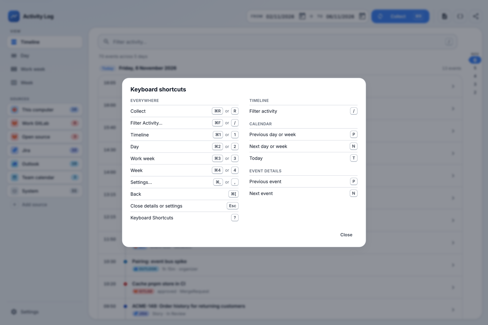
</p>

### Export

The header buttons export the current filtered view (including overnight meetings drawn on calendar views) as **Markdown** grouped by day in your local time zone or as a full **JSON** `ActivityLog` (`meta`, `summary`, `entries`). In the browser, files download as `activity-<first>-<last>.md` or `.json`; in the desktop app, export opens a native save dialog. Ranges span `[start, end)` up to 10 years.

```markdown
# Activity Summary — 2026-11-02 00:00 to 2026-11-07 00:00

Total: 70 events

## Friday, 6 November 2026

- **[gitlab]** merged: Order history page (16:05)
- **[calendar]** Weekly sync (16:00, 30m)
- **[git]** `web-portal` docs: add order history to changelog (15:40)
- **[outlook]** Sprint 47 retro @ Room Ada (14:30, 1h)
- **[outlook]** Sprint 47 review @ Room Ada / Teams (14:00, 1h)
- **[jira]** ACME-151: Flaky e2e: cart badge count after login [Done] (13:15)
```

## Sources in detail

| Source       | What it collects                                             | Platforms             | Multiple connections | Cached on disk |
| ------------ | ------------------------------------------------------------ | --------------------- | -------------------- | -------------- |
| **Git**      | Commits from local repositories (and WSL on Windows)         | Windows, macOS, Linux | Yes                  | No             |
| **GitLab**   | Merge requests, pushes, comments, and reviews                | Windows, macOS, Linux | Yes                  | Yes            |
| **Jira**     | Issues assigned to or reported by you (Jira Data Center)     | Windows, macOS, Linux | Yes                  | Yes            |
| **Outlook**  | Calendar meetings from the running Outlook desktop app       | Windows, macOS        | No                   | No             |
| **Calendar** | Events from `https://`/`webcal://` ICS feeds or `.ics` files | Windows, macOS, Linux | Yes                  | No             |
| **System**   | Boot, shutdown, and (macOS) sleep/wake sessions              | Windows, macOS        | No                   | No             |

Each source below lists its entry types, Timeline subtitle line, detail panel fields (empty fields are omitted), and configuration keys.

### Git

<table>
<tr>
<td width="56%" valign="top">

- **Entries:** One per commit authored with any of your emails across all refs, matched case-insensitively against every `user.email` found across your configured Git connections (local configs and WSL global configs). Commits are filtered by author time, walking 30 days of committer history before the range so rebased commits are not missed. Worktrees and duplicate clones are deduplicated by commit hash.
- **Timeline line:** repository · branch (`HEAD` commit only) · 7-character hash
- **Detail panel:** Repository, Branch, Commit (full hash), Author, Message (plus a GitLab section when merged into a **git/lab** entry)
- **Integration:** Library-backed (`gix`, in-process) on local disks; runs `git` inside the distribution (`wsl.exe -d <distro>`) for WSL connections on Windows.
- **Configuration:** Optional `dirs` list (folders with `.git` are read directly; other folders are scanned up to 4 levels deep; unset defaults to your home folder, or `~` in WSL; an empty list `[]` scans nothing) and optional `wsl` distribution name on Windows. When adding a Git source on Windows, **Add source** lists this computer and user WSL distributions (skipping Docker, Rancher, and Podman distributions).

</td>
<td width="44%" valign="top"></td>
</tr>
</table>

### GitLab

<table>
<tr>
<td width="56%" valign="top">

- **Entries:** One per event in the GitLab event feed of the configured `user`. Title is the target title (for example the merge request title), or the action name when absent.
- **Actions:** `pushedTo`, `pushedNew`, `created`, `opened`, `closed`, `reopened`, `updated`, `merged`, `accepted`, `commentedOn`, `approved`, `joined`, `destroyed`, `expired`, and `unknown`.
- **Timeline line:** action · target type (for example `merged · MergeRequest`)
- **Detail panel:** Action, Title, Target type, MR (`!iid`), Issue (`#iid`), Branch, Commits, File, Comment, Resolved
- **Merge:** Push events (`pushedTo`, `pushedNew`) whose commit SHA matches a local Git commit fold into that commit's **git/lab** entry.
- **Stack:** When a merge request event's merge request is still open and part of a stack, its detail panel shows a **Stack** section: the branch it builds on, the open merge requests below it, and those built on it, each linked to its page on the configured GitLab server. The stack is looked up fresh on every collection (never cached), which can delay that connection's entries by up to about 20 seconds on a slow server, and needs a token that can read the project's merge requests (`read_api` or `api`); without that scope, entries show without stacks and **Settings → Logs** says why.
- **Configuration:** `url`, `token`, and `user` (all required). Tokens are sent only to the configured origin (cross-origin redirects are rejected). Uses the [per-day cache](#per-day-cache).

</td>
<td width="44%" valign="top"></td>
</tr>
</table>

### Jira Data Center

<table>
<tr>
<td width="56%" valign="top">

- **Entries:** Issues assigned to or reported by you on **Jira Data Center** (REST API v2 with Personal Access Token / Bearer authentication; Jira Cloud is not supported).
  - `issueCreated`: issue created in the date range.
  - `statusChanged`: one entry per status transition in the date range.
  - `issueUpdated`: latest update falls in the date range and is not a status change.
- **Timeline line:** issue type · status
- **Detail panel:** Event, Key, Title, Status, Issue type, From status, To status
- **Configuration:** `url` and `token` (required), `insecure` (optional boolean to accept self-signed certificates). Uses the [per-day cache](#per-day-cache).

</td>
<td width="44%" valign="top">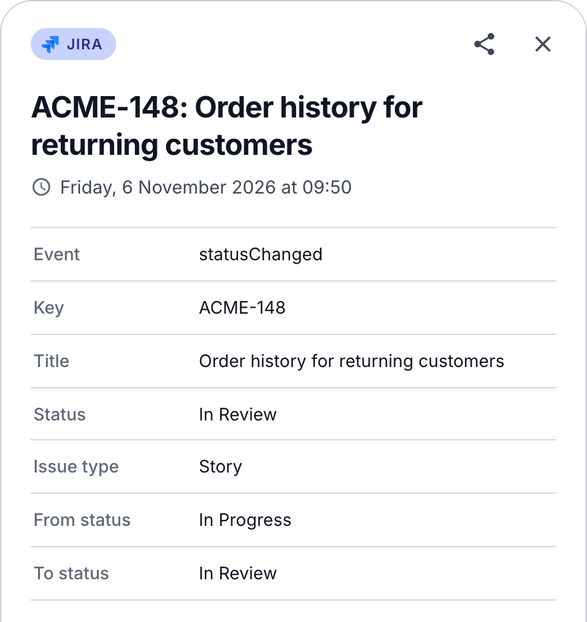</td>
</tr>
</table>

### Outlook

<table>
<tr>
<td width="56%" valign="top">

- **Entries:** Events from Outlook's default calendar overlapping the date range. Meetings without a title display as `(No title)`.
- **Timeline line:** duration · location · role (`organizer` or `attendee`) · `org:` organizer (when you are not the organizer)
- **Detail panel:** Title, Duration, Status (busy status), Location, Organizer, Role, **Join meeting** button for online meetings, and Description
- **Integration:** Native provider integration (COM on Windows classic Outlook; AppleScript via `osascript` on macOS). Activity Log never launches Outlook—it collects only while Outlook is running.
- **Configuration:** None (`[[outlook]]`). On Windows, classic Outlook is required (the new Outlook has no COM API, and Outlook running elevated cannot be reached). On macOS, a signed-in Exchange account is required. If you use the new Outlook, publish your calendar and add it as a [Calendar](#calendar) source instead.

</td>
<td width="44%" valign="top">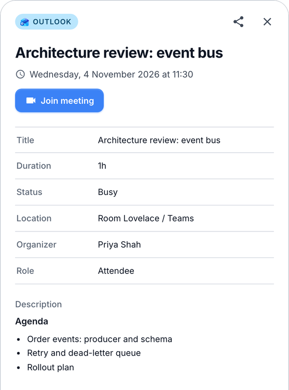</td>
</tr>
</table>

### Calendar

<table>
<tr>
<td width="56%" valign="top">

- **Entries:** Non-cancelled, non-all-day events from an ICS feed overlapping the date range, with recurring series expanded (including moved and cancelled occurrences, capped at 50,000 occurrences per series with a warning). Meetings without a title display as `(No title)`.
- **Timeline line:** duration · location · `org:` organizer
- **Detail panel:** Title, Duration, Status (busy status), Location, Organizer, **Join meeting** button (Teams, Zoom, Google Meet, Webex, or calendar conference properties, `https://` only), and formatted Description (capped at 4,000 characters; unwraps Outlook Safe Links, trims Teams dial-in blocks, drops tracking pixels and `cid:` attachments, and opens links in your browser).
- **Configuration:** `ics_url` (required): an `https://` or `webcal://` URL, or an absolute path / `file://` URL to a local `.ics` file. Plain `http://` is refused because calendar links act as secrets. The URL is stored as plain text in `config.toml`; Settings never shows it again, and it is never written to logs. Floating times and unknown time zones use the machine's local time zone (unknown `TZID`s log a warning).

</td>
<td width="44%" valign="top">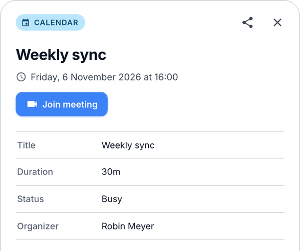</td>
</tr>
</table>

### System

<table>
<tr>
<td width="56%" valign="top">

- **Entries on Windows:** Event Log events `6005` (`boot`), `6006` (`shutdown`), and `6008` (`unexpected_shutdown`).
- **Entries on macOS:** Reboot and shutdown records from `last` (`boot`, `shutdown`), plus user-visible sleep and wake events from `pmset -g log` (`sleep`, `wake`, excluding dark wakes and maintenance cycles; macOS retains roughly a week of power logs). Commands run in the C locale so parsing works in any system language.
- **Timeline line:** event type
- **Detail panel:** Event type, Label
- **Configuration:** None (`[[system]]`)

</td>
<td width="44%" valign="top"></td>
</tr>
</table>

## Configuration

### Config file

The desktop app, API server, and CLI share one TOML file: `activity-log/config.toml` inside the OS config directory (`%APPDATA%` on Windows, `~/Library/Application Support` on macOS, `$XDG_CONFIG_HOME` or `~/.config` on Linux). Override it with `ACTIVITY_LOG_CONFIG` or `--config <path>` (CLI and API server). Run `pnpm cli:collect config path` to print the active path.

Each connection is a TOML array-of-tables entry under its kind, using lowercase field names without the kind prefix:

```toml
[[gitlab]]
label = "Work GitLab"
url = "https://gitlab.example.org"
token = "glpat-example-work"
user = "alex"

[[gitlab]]
name = "oss"
label = "Open source"
url = "https://oss.example.org"
token = "glpat-example-oss"
user = "alex"

[[jira]]
label = "Work Jira"
url = "https://jira.example.org"
token = "pat-example"

[[git]]
label = "This computer"
dirs = ["~/Projects"]

[[git]]
label = "WSL · NixOS"
wsl = "NixOS"
dirs = ["~", "/srv/tools"]

[[calendar]]
label = "Team"
ics_url = "https://calendar.example.org/team/calendar.ics"

[[outlook]]

[[system]]
```

Key rules:

- **Explicit sources only:** `config.toml` is the only list of sources. A missing or empty file means no sources; environment variables never configure a source.
- **Connection names and labels:** A connection's ID is `<kind>/<name>` (for example `gitlab/oss`). When `name` is omitted, it is slugged from `label` (`Work GitLab` → `work-gitlab`) and stays fixed if you later rename the label. Duplicate names are numbered (`work-2`) with a warning.
- **Private writes and locking:** Because `config.toml` holds tokens, Activity Log writes it atomically through a verified owner-only staging folder under a `config.toml.lock` lock (macOS, Linux, and Windows). Unprotectable locations (FAT, exFAT, network shares, or folders writable by other accounts) are refused before writing.
- **Live reload:** The desktop app and API server check `config.toml` every 2 seconds (the API also checks before answering collection or provider requests) and install edits once stable for 0.2 seconds. Parse errors log only the line and column—never the file contents—and keep the last valid configuration running.

### Environment variables

These optional variables (the CLI and API server also read them from `.env`) control file locations, API port, and cache TTL:

| Variable                 | Description                                                              | Default             |
| ------------------------ | ------------------------------------------------------------------------ | ------------------- |
| `ACTIVITY_LOG_CONFIG`    | Path to `config.toml`                                                    | OS config directory |
| `PORT`                   | Rocket API port (`pnpm dev` and `pnpm api:dev` set `3001`)               | `3000`              |
| `CACHE_TTL_MINUTES`      | Minutes that recent (not yet settled) cached GitLab/Jira days stay fresh | `5`                 |
| `ACTIVITY_LOG_CACHE_DIR` | Directory for per-day cache files                                        | OS cache directory  |

### Per-day cache

GitLab and Jira results are cached on disk by UTC calendar day under `activity-log/cache` in the OS cache directory (`%LOCALAPPDATA%` on Windows, `~/Library/Caches` on macOS, `$XDG_CACHE_HOME` or `~/.cache` on Linux), or `ACTIVITY_LOG_CACHE_DIR`.

- **Minimal fetches:** Each collection serves fresh cached days and fetches only contiguous runs of missing or stale days. Fresh days between two stale spans are not re-fetched.
- **Recent vs settled days:** A UTC day is **settled** once it was fetched at least **1 hour after that UTC day ended**; settled days stay fresh for **7 days**. Any day fetched while still running or within 1 hour after it ended is **recent** and stays fresh for `CACHE_TTL_MINUTES` (default **5 minutes**). Days not refreshed for **60 days** are pruned.
- **Account-scoped and private:** Each cache file is keyed by connection settings and the authenticated principal from the startup check (Jira `/myself`, GitLab `/user`), so switching tokens to another account never serves the previous account's cache. Connections without a verified identity—or with a query or fragment in their URL—run uncached (URLs containing a username or password are rejected). Cache files are owner-only; if the cache directory cannot enforce privacy, Activity Log collects uncached and logs a warning once.
- **Safe across processes:** The desktop app, API server, and CLI can share one cache directory. Each process fetches without holding a lock, then locks the file, merges only the days it fetched (keeping newer timestamps), and writes atomically.

## CLI

Run collections and manage `config.toml` without building the dashboard.

### Collecting activity

| Flag                | Description                                                                                             |
| ------------------- | ------------------------------------------------------------------------------------------------------- |
| `--range <preset>`  | `today`, `yesterday`, `week`, `lastweek`, `month`, or `lastmonth`                                       |
| `--since <date>`    | Start local day (`YYYY-MM-DD`); defaults to 30 days ago without `--range`                               |
| `--until <date>`    | End local day (`YYYY-MM-DD`); defaults to today without `--range`                                       |
| `--format <format>` | `json` (default) or `markdown`                                                                          |
| `--output <path>`   | Output file path (default: `logs/activity_log.json` or `.md`); `-` writes the export to standard output |
| `--config <path>`   | Config file path (overrides `ACTIVITY_LOG_CONFIG` and default location)                                 |

Dates are whole local days. `--range week` and `--range lastweek` start on Monday, as in the dashboard.

Each source gets one line: collected with its entry count, skipped when it has nothing to give on this machine (another OS, an app not installed or not running, no repositories), or failed. With `--output -` the export alone goes to standard output and every other line to standard error (run it as `pnpm -s cli:collect`, or the binary itself, so pnpm's banner stays out of the export).

Exit status: 0 when every source was collected or skipped (another OS, not installed, not running, nothing to read); 1 when a source failed (refused, unreachable, timed out, not configured, not permitted, its check or its collection failed), after the export of the others is written, or on any error, an invalid flag or value included.

```bash
pnpm cli:collect --range week
pnpm cli:collect --range lastmonth --format markdown --output reports/last-month.md
pnpm cli:collect --since 2026-11-01 --until 2026-11-14
pnpm -s cli:collect --range today --output - | jq '.entries | length'
```

### Managing sources

Identify a connection as `kind/name`, or by `name` alone when unique. Input is validated identically to the desktop app before saving.

```bash
pnpm cli:collect sources                              # list connections and startup status
pnpm cli:collect sources add gitlab                   # prompt for url, token (hidden), user
pnpm cli:collect sources add gitlab --label "Work"    # custom label
pnpm cli:collect sources add git --wsl NixOS          # WSL Git connection on Windows
pnpm cli:collect sources set gitlab/oss url https://oss.example.org
pnpm cli:collect sources set gitlab/oss token         # prompt without echo
pnpm cli:collect sources set git/this-computer dirs ~/Projects ~/work
pnpm cli:collect sources unset git/this-computer dirs # restore default
pnpm cli:collect sources rename gitlab/oss "Open source"
pnpm cli:collect sources remove gitlab/oss
pnpm cli:collect config path                          # print config.toml path
pnpm cli:collect config edit                          # edit a private copy in $VISUAL / $EDITOR
```

## API

Start the Rocket HTTP API alone with `pnpm api:start` (default port `3000`, override with `PORT`), or alongside the Angular dev server with `pnpm dev` (API on `3001`, dashboard on `3200` with `/api` proxied and SSE streaming preserved). The API is local and collection-only; configuration edits stay in the desktop app and CLI.

| Method & Route                  | Description                                                                                                                    |
| ------------------------------- | ------------------------------------------------------------------------------------------------------------------------------ |
| `GET /api/events`               | Server-sent events (`text/event-stream`) pushing live host state; see below                                                    |
| `GET /api/runtime-state`        | Coherent `RuntimeState` pair (`activity` + `providers` with stamps); `activity.state` is `empty` before the first collection   |
| `GET /api/activity`             | Last collection log: `202` partial log (`meta.pending`), `200` complete log or `CollectionFailedResponse`, `503` if none yet   |
| `GET /api/providers`            | Per-connection startup status, typed `problem`, `recheckable`, and `degraded` state after a failed collection                  |
| `POST /api/collect`             | Body `{ "start", "end" }` (RFC 3339, `[start, end)`, max 10 years). Starts or joins a run; answers `202`/`200` `CollectAnswer` |
| `POST /api/connections/recheck` | Body `{ "source", "name" }`. Re-runs startup check and re-collects that kind; answers `200` `RecheckAnswer` (`404` if unknown) |
| `POST /api/export`              | Body `{ "format", "start", "end", "timeZone", "entries" }` (up to 64 MiB). Returns `{ "fileName", "content" }`                 |
| `GET /api/logs`                 | In-memory diagnostic log entries                                                                                               |
| `DELETE /api/logs`              | Clear in-memory diagnostic logs (`204`)                                                                                        |

### Live event stream (`GET /api/events`)

Clients follow collection progress and source changes through `GET /api/events` rather than polling:

- **Events:** Every frame is one line of compact JSON with no event ID and no replay:
  - `state`: full `RuntimeState` pair (`activity` + `providers`), sent first on connect, after every installed `config.toml` change, and whenever a startup check discovers a token now belongs to a different account.
  - `activity`: `{ "epoch", "authority", "revision", "state" }` as collection snapshots arrive or finish.
  - `providers`: `{ "epoch", "authority", "revision", "providers" }` as startup checks or collection failures update a source.
  - `ping`: `{ "epoch" }` sent every 15 seconds while idle.
- **Ordering stamps:** `epoch` identifies the server process, `authority` increments on config installs and account switches, and `revision` comes from one host-wide counter shared by both parts: each part carries the revision at which it last changed. A slow reader skips intermediate updates, never the latest state of either part.
- **Try it:** `curl -N http://localhost:3000/api/events`

### Error responses

Every API error returns `{ "kind", "error" }`, where `error` is human-readable and `kind` is one of the typed `BackendErrorKind` values (`noData`, `invalidRequest`, `notFound`, `alreadyExists`, `busy`, `conflict`, `noLocation`, `unprotectable`, `badConfig`, `tooLarge`, `internal`).

## Development

### Workspace layout

| Directory    | Role                                                                           |
| ------------ | ------------------------------------------------------------------------------ |
| `core/`      | Shared Rust models, collectors, per-day cache, merge logic, export, TS codegen |
| `api/`       | Rocket HTTP API over `core::runtime::Host`                                     |
| `cli/`       | Standalone `activity-log` CLI and `generate-ts` contract generator             |
| `desktop/`   | Tauri v2 shell exposing Rust commands and events to the Angular UI             |
| `dashboard/` | Angular frontend consuming generated DTOs from `dashboard/src/app/generated/`  |

Architecture rules and conventions live in [`AGENTS.md`](AGENTS.md); domain terminology lives in [`CONTEXT.md`](CONTEXT.md).

### Verification

Run the repository verification gate before considering any change complete:

```bash
pnpm verify
```

`pnpm verify` checks generated TypeScript contract drift (`pnpm types:check`), formatting (`cargo fmt` + Prettier), Rust compilation, Clippy, Rust tests, Angular ESLint + lint tests, dashboard unit tests, Playwright layout tests (`*.layout.spec.ts`), Angular type-checking, and the dashboard build.

Install the headless Chromium shell once for the layout tests:

```bash
pnpm dashboard:browsers
```

For Windows-specific backend coverage from macOS or Linux:

```bash
pnpm core:test:windows                        # host-runnable Windows logic tests
nix develop .#windows -c pnpm win:check       # full Windows target Clippy check
```

See [`docs/testing-windows-on-mac.md`](docs/testing-windows-on-mac.md) for the full Windows testing workflow.

### Common tasks

```bash
pnpm types:generate                           # regenerate dashboard/src/app/generated/ from Rust
pnpm types:check                              # verify generated TypeScript matches Rust
ACTIVITY_LOG_DEVTOOLS=1 pnpm desktop:dev      # desktop dev build with web inspector open
pnpm desktop:build                            # build desktop bundle for the current OS
nix develop .#windows -c pnpm desktop:build:windows  # cross-build Windows NSIS installer
pnpm --dir dashboard exec tauri icon src/favicon.svg -o ../desktop/icons  # regenerate app icons
```

## Coming next

These items are in progress or planned and are not yet part of the current build:

- Additional sources: GitHub, Microsoft Teams, Figma, Miro, and Odoo
