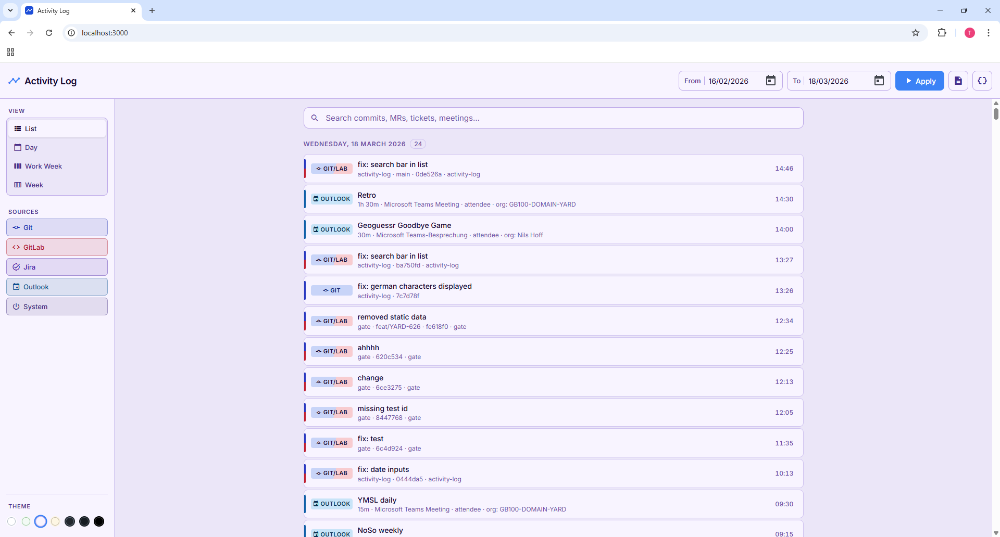

# activity-log - your MONI companion when your outlook calendar just aint doing it

A unified activity tracker that aggregates everything you did into a single timeline — commits, GitLab events, Jira issues, calendar meetings, and system events.

The backend is now a Rust workspace:

- `core` contains shared DTOs, collectors, cache, merge logic, markdown export, and TS generation.
- `api` exposes the Rocket API.
- `cli` provides the standalone collection CLI and a separate TypeScript generator binary for Angular.

The Angular app stays in `dashboard/` and now consumes generated DTOs from `dashboard/src/app/generated/`.

## Screenshots




## Data sources

| Source      | What it collects                                           |
| ----------- | ---------------------------------------------------------- |
| **Git**     | Commits from all local repositories                        |
| **GitLab**  | MRs, pushes, comments, reviews                             |
| **Jira**    | Issues you worked on or reported                           |
| **Outlook** | Calendar events (via local Outlook desktop app)            |
| **System**  | Boot, shutdown, sleep, and wake events (Windows Event Log) |

When a local git commit matches a GitLab push event (same commit SHA), they are merged into a single **git/lab** entry instead of appearing twice.

## Requirements

- Rust toolchain (`cargo`, `rustc`)
- [Node.js](https://nodejs.org) >= 20
- [pnpm](https://pnpm.io) >= 10
- Git installed locally
- Windows (for Outlook and System collectors — others work cross-platform)

## Setup

```bash
git clone https://github.com/wiwiwi-inc-tm/activity-log.git
cd activity-log
pnpm install
cp .env.example .env   # fill in your credentials
```

---

## Option A — UI (web dashboard)

### First-time only: build the dashboard

```bash
pnpm dashboard:install
pnpm dashboard:build
```

### Start the API server

```bash
pnpm api:start
```

The API listens on [http://localhost:3000](http://localhost:3000) by default. The last 30 days are collected automatically on startup. Use the date pickers in the header to change the range and re-collect on the fly.

Run the Angular dev server separately with `pnpm dashboard:dev`, or use the combined dev mode below.

The header has two export buttons:

- **Markdown** (`description` icon) — downloads a `.md` summary of the current filtered view
- **JSON** (`data_object` icon) — downloads the raw entries as `.json`

### Development mode (hot reload)

```bash
pnpm dev
# API server  → http://localhost:3001
# Dashboard   → http://localhost:4200  (live reload)
```

---

## Option B — CLI

No dashboard build needed.

```bash
pnpm cli:collect --range today
pnpm cli:collect --range yesterday
pnpm cli:collect --range week
pnpm cli:collect --range lastweek
pnpm cli:collect --range month
pnpm cli:collect --range lastmonth
pnpm cli:collect --since 2026-03-01 --until 2026-03-18
```

### Output format

Default output is JSON. Use `--format markdown` to get a Markdown summary instead:

```bash
pnpm cli:collect --format json            # → logs/activity_log.json  (default)
pnpm cli:collect --format markdown        # → logs/activity_log.md
```

Override the output path with `--output`:

```bash
pnpm cli:collect --range week --output reports/week.json
pnpm cli:collect --range week --format markdown --output reports/week.md
```

### Other options

```bash
--git-dirs /path/to/repo1,/path/to/repo2   # scan specific repos instead of auto-discovering
```

### Generate Angular DTO types

```bash
pnpm types:generate
```

This writes Rust-backed DTO types into `dashboard/src/app/generated/`.

## Verification

Run this before treating changes as done:

```bash
pnpm verify
```

`verify` is the repo-wide gate. It runs TypeScript generation, formatter checks, Rust checks, clippy, Rust tests, Angular type-checking, and the dashboard build.

---

## Environment variables

Copy `.env.example` to `.env` and fill in the sources you want to enable. Any source without credentials is silently skipped.

| Variable        | Description                                                                  |
| --------------- | ---------------------------------------------------------------------------- |
| `GITLAB_URL`    | Your GitLab instance URL                                                     |
| `GITLAB_TOKEN`  | GitLab personal access token                                                 |
| `GITLAB_USER`   | Your GitLab username                                                         |
| `JIRA_URL`      | Your Jira instance URL                                                       |
| `JIRA_EMAIL`    | Your Jira account email                                                      |
| `JIRA_TOKEN`    | Jira API token (or PAT for Jira Data Center)                                 |
| `JIRA_INSECURE` | Set to `true` to skip TLS verification (self-signed certs)                   |
| `GIT_DIRS`      | Comma-separated paths to Git repos (auto-discovers from home dir if not set) |
| `PORT`          | Server port (default: `3000`, UI mode only)                                  |

Outlook and System collectors require no credentials — they read from the local Outlook app and Windows Event Log respectively.

---

## Project structure

```text
activity-log/
├── core/
│   └── src/
│       ├── collect/           Git, GitLab, Jira, Outlook, System collectors
│       ├── cache/             File-based TTL cache for API responses
│       ├── model/             Shared models grouped by domain/source
│       ├── ts.rs              Angular DTO generator
│       └── utils/             Date utilities, markdown formatter, git/gitlab merge
├── api/                       Rocket API crate
├── cli/                       Rust CLI crate
├── dashboard/
│   └── src/app/
│       ├── components/        header, filters, timeline, calendar views
│       ├── generated/         Rust-generated DTOs
│       ├── services/          ActivityService, ThemeService
│       ├── models/            Angular-only view models
│       └── utils/             Angular-only helper logic
├── logs/                      Generated output (gitignored)
├── Cargo.toml
├── .env.example
├── package.json
└── README.md
```
